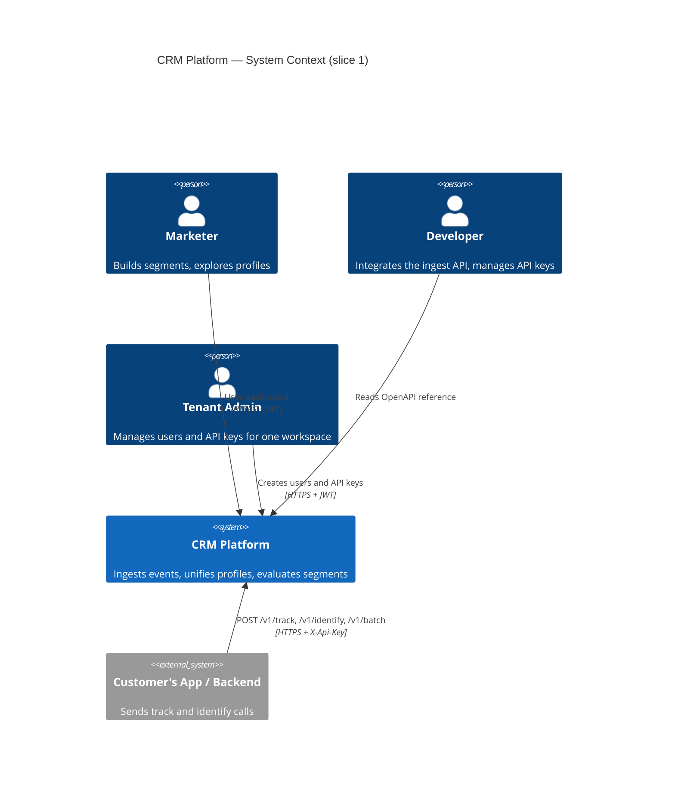
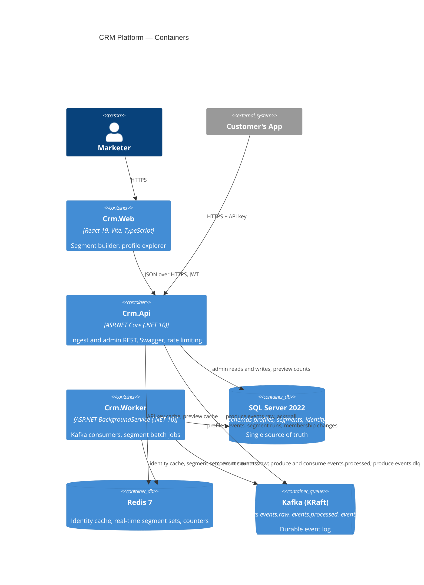
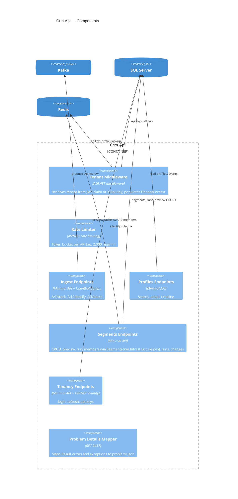
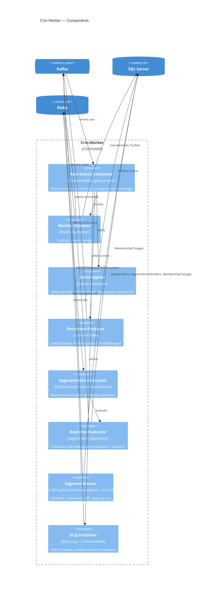
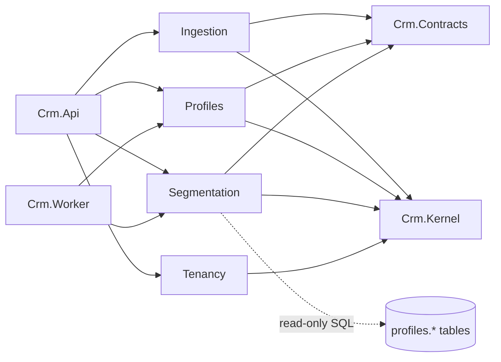

# Architecture — CRM Platform, Slice 1

This document visualizes the design in the [slice 1 spec](../superpowers/specs/2026-09-15-crm-slice1-design.md). Diagrams use the C4 model at three levels, followed by a module map and sequence diagrams for the four core flows. Decisions are recorded in the [ADRs](../adr/README.md).

## 1. System Context



## 2. Containers



## 3. Components

### 3.1 Crm.Api



### 3.2 Crm.Worker



## 4. Module Map

| Module | Projects | Owns | Depends on | Talks to others via |
|---|---|---|---|---|
| Ingestion | Application, Infrastructure | validation, event envelope, Kafka producer | Kernel, Contracts | `events.raw` topic |
| Profiles | Domain, Application, Infrastructure | schema `profiles`, identity resolution, merge, timeline | Kernel, Contracts | consumes `events.raw`; produces `events.processed` |
| Segmentation | Domain, Application, Infrastructure | schema `segments`, rule compiler, runner, real-time evaluator | Kernel, Contracts | consumes `events.processed`; reads `profiles.*` tables read-only ([ADR 0009](../adr/0009-segmentation-reads-profiles-tables.md)) |
| Tenancy | Domain, Application, Infrastructure | schema `identity`, tenants, users, API keys, JWT | Kernel | `ITenantContext` (Kernel) |
| Crm.Contracts | class library | integration events `TrackEventRaw`, `IdentifyRaw`, `EventTracked`, `ProfileUpdated`, `ProfileMerged`; shared DTOs | — | — |
| Crm.Kernel | class library | `Entity`, `Result<T>`, `ITenantContext`, `IClock`, error types | — | — |

Dependency rules enforced by `Crm.ArchTests`:



## 5. Sequence Diagrams

### 5.1 Track event

```mermaid
sequenceDiagram
  participant SDK as Customer App
  participant Api as Crm.Api
  participant Kafka
  participant Worker as Crm.Worker (profiles)
  participant Redis
  participant SQL as SQL Server
  SDK->>Api: POST /v1/track (X-Api-Key)
  Api->>Api: resolve tenant, validate, EventId = UUIDv7
  Api->>Kafka: produce events.raw key tenant:user (acks=all)
  Api-->>SDK: 202 { eventId }
  Kafka->>Worker: consume
  Worker->>Redis: GET t:{tenant}:id:{kind}:{value}
  alt cache miss
    Worker->>SQL: SELECT UserIdentities / INSERT Profile + Identity
    Worker->>Redis: SET identity cache (TTL 1h)
  end
  Worker->>SQL: BEGIN; UPDATE Profile LastSeenAt, EventCount; INSERT Event; COMMIT
  Worker->>Kafka: produce events.processed EventTracked
  Worker->>Kafka: commit offset
```

### 5.2 Identify with merge

```mermaid
sequenceDiagram
  participant SDK as Customer App
  participant Api as Crm.Api
  participant Kafka
  participant Worker as Crm.Worker (profiles)
  participant SQL as SQL Server
  participant Redis
  SDK->>Api: POST /v1/identify { userId: U, anonymousId: A, traits }
  Api->>Kafka: events.raw IdentifyRaw
  Kafka->>Worker: consume
  Worker->>SQL: resolve anonymous_id:A -> Profile P1, external_id:U -> Profile P2
  alt P1 != P2
    Note over Worker,SQL: UPDLOCK on both profile rows for the whole transaction
    Worker->>SQL: winner = older FirstSeenAt
    Worker->>SQL: UPDATE Events SET ProfileId=winner WHERE ProfileId=loser
    Worker->>SQL: UPDATE UserIdentities SET ProfileId=winner WHERE ProfileId=loser
    Worker->>SQL: merge Attributes (winner values win); SET loser.MergedIntoId=winner
    Worker->>Redis: DEL identity cache entries for loser
  end
  Worker->>SQL: JSON_MODIFY traits per key on winner; COMMIT
  Worker->>Kafka: events.processed ProfileMerged (if merged), ProfileUpdated
```

### 5.3 Batch segment run

```mermaid
sequenceDiagram
  participant UI as Crm.Web
  participant Api as Crm.Api
  participant Runner as Segment Runner (Worker)
  participant SQL as SQL Server
  participant Redis
  UI->>Api: POST /v1/segments/{id}/run
  Api->>SQL: INSERT SegmentRuns (Status=Queued)
  Api-->>UI: 202 { runId }
  Runner->>SQL: poll SegmentRuns WHERE Status=Queued (every 5 s)
  Runner->>SQL: compile rule tree; UPDATE run Status=Running, CompiledSql
  Runner->>SQL: INSERT SegmentRunMembers SELECT ... (5 min timeout)
  Runner->>SQL: INSERT MembershipChanges (new EXCEPT current = Entered; current EXCEPT new = Exited)
  Runner->>SQL: UPDATE Segments SET CurrentRunId, MemberCount, LastRunAt; run Status=Finished
  opt real-time eligible
    Runner->>Redis: DEL + SADD t:{tenant}:seg:{id}:members from run
  end
  Runner->>SQL: DELETE runs older than last 3
```

### 5.4 Real-time segment evaluation

```mermaid
sequenceDiagram
  participant Kafka
  participant Seg as Segmentation Consumer (Worker)
  participant Cache as In-memory segment cache
  participant Redis
  participant SQL as SQL Server
  Kafka->>Seg: events.processed EventTracked | ProfileUpdated { tenant, profile snapshot, event? }
  Seg->>Cache: eligible Active segments for tenant
  loop each segment referencing event.name
    Seg->>Redis: INCR t:{tenant}:seg:{seg}:ev:{eventName}:{window}:{profile}; EXPIRE window NX
  end
  loop each eligible segment
    Seg->>Seg: evaluate rule tree (snapshot + counters)
    alt now member, was not
      Seg->>Redis: SADD members
      Seg->>SQL: INSERT MembershipChanges Entered (Source=Realtime)
    else was member, now not
      Seg->>Redis: SREM members
      Seg->>SQL: INSERT MembershipChanges Exited (Source=Realtime)
    end
  end
  Seg->>Kafka: commit offset
```

## 6. Rule Compiler Mapping

JV = `JSON_VALUE(p.Attributes, '$.key')` or the promoted column.

| Node / cmp | SQL fragment | Missing-key semantics |
|---|---|---|
| attribute eq | `JV = @p` | excluded |
| attribute neq | `(JV <> @p OR JV IS NULL)` | included |
| attribute in | `JV IN (@p0, @p1, …)` | excluded |
| attribute nin | `(JV NOT IN (@p0, …) OR JV IS NULL)` | included |
| attribute eq/neq/in/nin with a numeric value | as above, with `JV` wrapped in `TRY_CONVERT(float, JV)` and float parameters (H17) | as above |
| attribute gt/gte/lt/lte | `TRY_CONVERT(float, JV) > @p` (etc.) | excluded (NULL compares UNKNOWN) |
| attribute contains | `JV LIKE '%' + @p + '%' ESCAPE '\'` with `\`, `%`, `_`, `[` escaped in @p (backslash first) | excluded |
| attribute exists | `JV IS NOT NULL` | excluded |
| attribute not_exists | `JV IS NULL` | included |
| event gte n (n ≥ 1) | `EXISTS (SELECT 1 FROM profiles.Events e WHERE e.TenantId=@t AND e.ProfileId=p.Id AND e.Name=@n AND e.OccurredAt>=@since HAVING COUNT(*) >= @c)` | — |
| event eq 0 | `NOT EXISTS (… same subquery without HAVING …)` | — |
| event eq n (n ≥ 1) | `EXISTS (… HAVING COUNT(*) = @c)` | — |
| event lte n | `NOT EXISTS (… HAVING COUNT(*) > @c)` | — |
| group and/or | `(c1 AND c2 …)` / `(c1 OR c2 …)` | — |
| group not | `NOT (c1)` | — |

Booleans are compared as the strings `true`/`false`. `@since` is not a SQL-side expression: the compiler computes it as `clock.UtcNow - window.Duration` and passes the result as a `DateTime` parameter, so the query's notion of "now" is the same clock the rest of the module uses (and is fixed at compile time, not re-evaluated per row).
