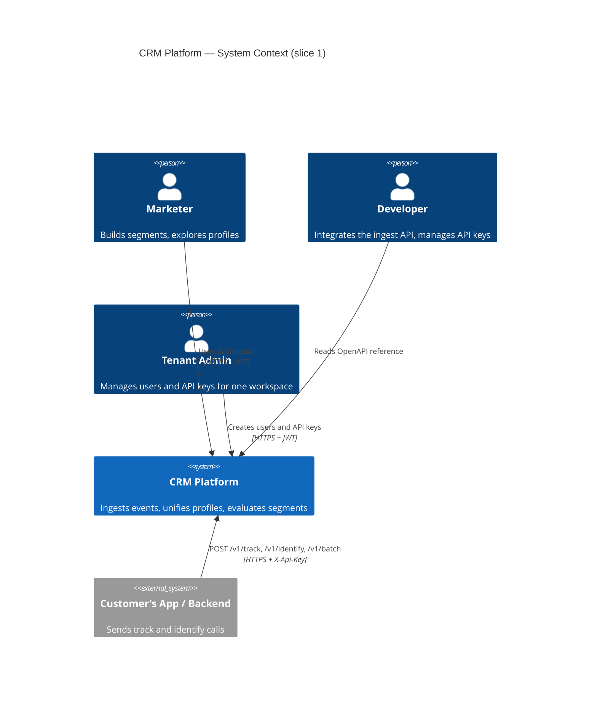
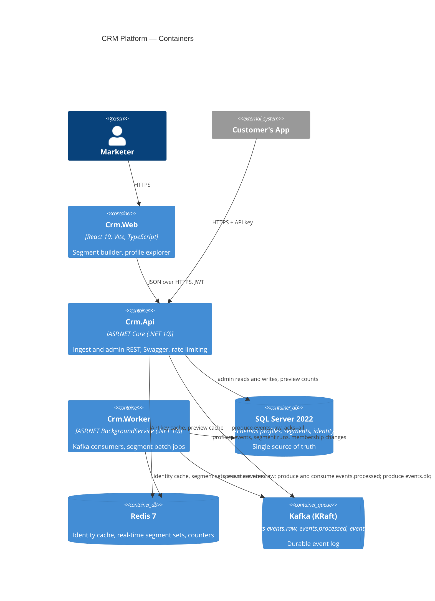
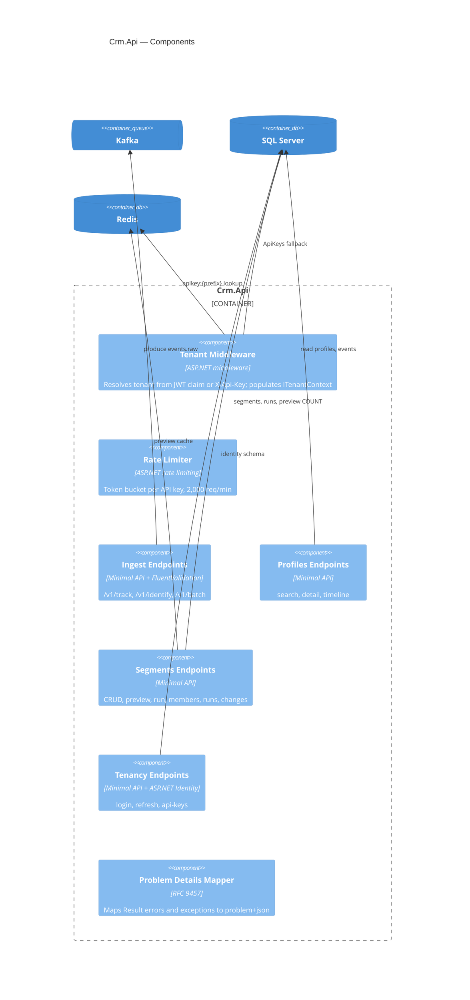
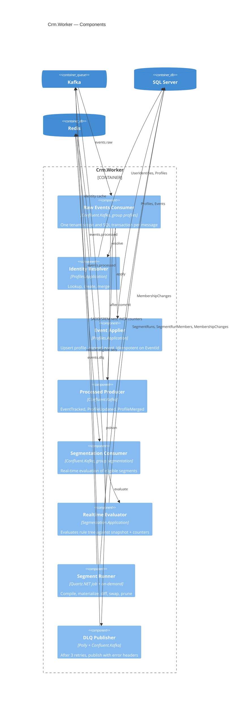
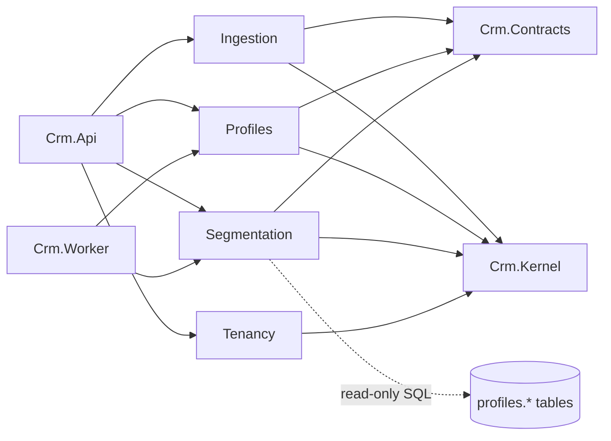

# CRM Slice 1 — Documentation Phase Implementation Plan

> **For agentic workers:** REQUIRED SUB-SKILL: Use superpowers:subagent-driven-development (recommended) or superpowers:executing-plans to implement this plan task-by-task. Steps use checkbox (`- [ ]`) syntax for tracking.

**Goal:** Produce the complete documentation set for slice 1 (BRD, nine ADRs, architecture document with C4 and sequence diagrams, data dictionary, API guide, README) with an automated checker that proves every document exists, has its required sections, and has no broken links or unbalanced diagram fences.

**Architecture:** Documentation lives under `docs/`, one directory per document type. A stdlib-only Python script `tools/docs_check.py` holds a manifest of required files and headings and validates relative links and Mermaid fences; each task adds a document that turns one manifest entry green. The design spec at `docs/superpowers/specs/2026-09-15-crm-slice1-design.md` is the source of truth; every document restates or expands it, never contradicts it.

**Tech Stack:** Markdown, Mermaid (C4 and sequence diagrams), MADR 3.0 ADR format, Python 3.12 (stdlib only) for the checker, git.

**Spec:** `docs/superpowers/specs/2026-09-15-crm-slice1-design.md`

## Global Constraints

- Every document is Markdown with Mermaid fenced diagrams; no images, no external diagram tools.
- ADRs follow MADR: `## Context and Problem Statement`, `## Decision Drivers`, `## Considered Options`, `## Decision Outcome`, `## Consequences`.
- ADR filenames: `docs/adr/NNNN-kebab-slug.md`, numbered 0001–0009 exactly as listed in spec §9.
- Technology names and versions are verbatim from the spec: .NET 10, React 19, SQL Server 2022, Redis 7, Kafka (KRaft), Vite, TanStack Router + Query, shadcn/ui, Zod, Confluent.Kafka, EF Core, Quartz.NET, Polly, Serilog, OpenTelemetry, Prometheus, Grafana, Jaeger, Testcontainers, NetArchTest, xUnit, Vitest, Playwright, k6.
- Numeric limits verbatim from spec: event name ≤ 64 chars, properties ≤ 32 KB, timestamp ±7 d, batch ≤ 500, rule depth ≤ 5, leaves ≤ 20, window ≤ 365 d, preview timeout 5 s, preview cache 60 s, rate limit 2,000 req/min per key, JWT 15 min access / 7 d refresh, keep last 3 runs, 12 Kafka partitions, retention raw 7 d / processed 7 d / dlq 30 d, load target 1,000 events/s for 60 s.
- Every relative link inside `docs/` must resolve to an existing file (the checker enforces this).
- Commit after every task with a `docs:` or `chore:` conventional-commit subject and the trailer `Co-Authored-By: Claude Fable 5.1 <noreply@anthropic.com>`.
- Run the checker with `python3 tools/docs_check.py` from the repository root.

---

## File structure

| Path | Responsibility |
|---|---|
| `tools/docs_check.py` | Manifest of required docs + headings; link and Mermaid fence validation; exit 1 on any error |
| `docs/README.md` | Index of the documentation set |
| `docs/brd/BRD.md` | Business Requirements Document |
| `docs/adr/README.md` | ADR index and how to add one |
| `docs/adr/template.md` | MADR template for future ADRs |
| `docs/adr/0001-modular-monolith.md` … `0009-segmentation-reads-profiles-tables.md` | One decision each |
| `docs/design/architecture.md` | C4 L1–L3, module map, sequence diagrams |
| `docs/design/README.md` | Points to the spec and architecture doc |
| `docs/data-dictionary/README.md` | Conventions, schema list |
| `docs/data-dictionary/profiles.md`, `segments.md`, `identity.md`, `redis-and-kafka.md` | Per-store field dictionaries |
| `docs/api/README.md` | Endpoint reference, auth, errors, pagination, curl examples |
| `README.md` | Root: project summary, status, links, planned quickstart |

---

### Task 1: Documentation checker and docs index

**Files:**
- Create: `tools/docs_check.py`
- Create: `docs/README.md`

**Interfaces:**
- Produces: `python3 tools/docs_check.py` → exit 0 when every manifest entry passes, exit 1 with one `ERROR path: message` line per failure. Later tasks run it to see their document go green.

- [ ] **Step 1: Write the checker (it is the test suite for this plan)**

```python
#!/usr/bin/env python3
"""Validate the docs/ tree: required files, required headings, relative links, Mermaid fences.

Usage: python3 tools/docs_check.py [--only PATH_PREFIX]
Exit 0 when clean, 1 when any ERROR line was printed.
"""
from __future__ import annotations

import re
import sys
from pathlib import Path

ROOT = Path(__file__).resolve().parents[1]

MADR = [
    "## Context and Problem Statement",
    "## Decision Drivers",
    "## Considered Options",
    "## Decision Outcome",
    "## Consequences",
]

ADRS = [
    (1, "modular-monolith"),
    (2, "kafka-ingestion"),
    (3, "sql-server-json-profiles"),
    (4, "shared-db-tenancy"),
    (5, "hybrid-segmentation"),
    (6, "redis-roles"),
    (7, "auth-model"),
    (8, "run-and-swap-membership"),
    (9, "segmentation-reads-profiles-tables"),
]

REQUIRED: dict[str, list[str]] = {
    "README.md": ["# ", "## Status", "## Documentation", "## Quickstart"],
    "docs/README.md": ["# CRM Documentation", "## Documents"],
    "docs/brd/BRD.md": [
        "# ",
        "## 1. Vision",
        "## 2. Personas",
        "## 3. Scope",
        "## 4. Functional Requirements",
        "## 5. Non-Functional Requirements",
        "## 6. Out of Scope",
        "## 7. Roadmap",
        "## 8. Glossary",
    ],
    "docs/adr/README.md": ["# Architecture Decision Records", "## Index", "## Adding an ADR"],
    "docs/adr/template.md": ["# "] + MADR,
    "docs/design/README.md": ["# Design"],
    "docs/design/architecture.md": [
        "# ",
        "## 1. System Context",
        "## 2. Containers",
        "## 3. Components",
        "## 4. Module Map",
        "## 5. Sequence Diagrams",
    ],
    "docs/data-dictionary/README.md": ["# Data Dictionary", "## Conventions", "## Schemas"],
    "docs/data-dictionary/profiles.md": ["# Schema `profiles`", "## Profiles", "## UserIdentities", "## Events"],
    "docs/data-dictionary/segments.md": [
        "# Schema `segments`",
        "## Segments",
        "## SegmentRuns",
        "## SegmentRunMembers",
        "## MembershipChanges",
    ],
    "docs/data-dictionary/identity.md": ["# Schema `identity`", "## Tenants", "## ApiKeys", "## Users"],
    "docs/data-dictionary/redis-and-kafka.md": ["# Redis Keys and Kafka Topics", "## Redis", "## Kafka"],
    "docs/api/README.md": [
        "# API Reference",
        "## Authentication",
        "## Errors",
        "## Pagination",
        "## Ingest",
        "## Profiles",
        "## Segments",
        "## Tenancy",
        "## Ops",
    ],
}
for number, slug in ADRS:
    REQUIRED[f"docs/adr/{number:04d}-{slug}.md"] = ["# "] + MADR

LINK_RE = re.compile(r"\[[^\]]*\]\(([^)\s]+)\)")


def check_headings(path: Path, text: str, headings: list[str]) -> list[str]:
    lines = text.splitlines()
    errors = []
    for heading in headings:
        if not any(line.startswith(heading) for line in lines):
            errors.append(f"missing heading '{heading}'")
    return errors


def check_links(path: Path, text: str) -> list[str]:
    errors = []
    for match in LINK_RE.finditer(text):
        target = match.group(1)
        if target.startswith(("http://", "https://", "mailto:", "#")):
            continue
        file_part = target.split("#", 1)[0]
        resolved = (path.parent / file_part).resolve()
        if not resolved.exists():
            errors.append(f"broken link '{target}'")
    return errors


def check_mermaid(path: Path, text: str) -> list[str]:
    fences = re.findall(r"^```(\w*)\s*$", text, flags=re.MULTILINE)
    if len(fences) % 2 != 0:
        return ["unbalanced code fences"]
    errors = []
    blocks = re.findall(r"^```mermaid\s*$(.*?)^```\s*$", text, flags=re.MULTILINE | re.DOTALL)
    for index, block in enumerate(blocks, start=1):
        first = next((line.strip() for line in block.splitlines() if line.strip()), "")
        if not re.match(r"^(C4Context|C4Container|C4Component|sequenceDiagram|flowchart|graph|erDiagram|classDiagram|stateDiagram)", first):
            errors.append(f"mermaid block {index} has unknown diagram type '{first[:30]}'")
    return errors


def main(argv: list[str]) -> int:
    only = None
    if len(argv) == 3 and argv[1] == "--only":
        only = argv[2]
    total_errors = 0
    for rel, headings in sorted(REQUIRED.items()):
        if only and not rel.startswith(only):
            continue
        path = ROOT / rel
        if not path.exists():
            print(f"ERROR {rel}: file missing")
            total_errors += 1
            continue
        text = path.read_text(encoding="utf-8")
        for message in check_headings(path, text, headings) + check_links(path, text) + check_mermaid(path, text):
            print(f"ERROR {rel}: {message}")
            total_errors += 1
    checked = sum(1 for rel in REQUIRED if not only or rel.startswith(only))
    print(f"checked {checked} documents, {total_errors} errors")
    return 1 if total_errors else 0


if __name__ == "__main__":
    sys.exit(main(sys.argv))
```

- [ ] **Step 2: Run the checker to verify it fails (all docs missing)**

Run: `python3 tools/docs_check.py`
Expected: many `ERROR ...: file missing` lines, last line `checked 24 documents, 24 errors`, exit code 1.

- [ ] **Step 3: Write the docs index**

```markdown
# CRM Documentation

Documentation for the MoEngage-style CRM platform. Slice 1 covers event ingestion, unified profiles, and segmentation. The design spec is the source of truth; every other document restates or expands it.

## Documents

| Document | Purpose |
|---|---|
| [Design spec (slice 1)](superpowers/specs/2026-09-15-crm-slice1-design.md) | Approved design: architecture, data model, pipeline, segmentation, API, UI, testing |
| [Business Requirements (BRD)](brd/BRD.md) | Vision, personas, scope, functional and non-functional requirements, roadmap |
| [Architecture](design/architecture.md) | C4 diagrams (context, container, component), module map, sequence diagrams |
| [Architecture Decision Records](adr/README.md) | Nine decisions in MADR format |
| [Data Dictionary](data-dictionary/README.md) | Tables, columns, indexes, Redis keys, Kafka topics |
| [API Reference](api/README.md) | Endpoints, authentication, errors, pagination, curl examples |

## Validation

Run `python3 tools/docs_check.py` from the repository root. It verifies every document above exists, has its required sections, has no broken relative links, and has well-formed Mermaid blocks.
```

- [ ] **Step 4: Run the checker scoped to the index**

Run: `python3 tools/docs_check.py --only docs/README.md`
Expected: `ERROR docs/README.md: broken link ...` for each not-yet-written document (five errors: brd, design, adr, data-dictionary, api), `checked 1 documents, 5 errors`. The spec link must not be reported. This confirms link checking works; these errors clear as later tasks land.

- [ ] **Step 5: Commit**

```bash
git add tools/docs_check.py docs/README.md
git commit -m "chore(docs): add documentation checker and docs index

Co-Authored-By: Claude Fable 5.1 <noreply@anthropic.com>"
```

---

### Task 2: Business Requirements Document

**Files:**
- Create: `docs/brd/BRD.md`

**Interfaces:**
- Produces: requirement IDs `FR-01`…`FR-24` and `NFR-01`…`NFR-10` referenced by later plans and by ADR "Decision Drivers" sections.

- [ ] **Step 1: Run the checker to verify the BRD is reported missing**

Run: `python3 tools/docs_check.py --only docs/brd`
Expected: `ERROR docs/brd/BRD.md: file missing`, exit 1.

- [ ] **Step 2: Write the BRD**

```markdown
# Business Requirements Document — CRM Platform, Slice 1

- **Version:** 1.0
- **Date:** 2026-09-15
- **Status:** Approved
- **Design spec:** [2026-09-15-crm-slice1-design.md](../superpowers/specs/2026-09-15-crm-slice1-design.md)

## 1. Vision

Build a MoEngage-style customer engagement platform as a portfolio project that demonstrates production-grade architecture: high-throughput event ingestion, identity resolution into unified customer profiles, and a segmentation engine that works both in batch and in real time. Slice 1 delivers the data foundation that every later capability (campaigns, journeys, analytics, channels, AI) builds on.

Project purpose is portfolio and learning. Documentation quality, testability, and clear architectural boundaries weigh as much as feature count. The system must run end-to-end on one developer machine with `docker compose`.

### Success metrics

| Metric | Target |
|---|---|
| Local startup | `docker compose up` brings up every service; README quickstart is three commands |
| Ingest-to-timeline latency | An event posted to `/v1/track` appears in the profile timeline within 2 s (p95, local) |
| Real-time segment latency | Eligible segment membership updates within 2 s of the triggering event |
| Tenant isolation | Integration test proves tenant A cannot read tenant B data |
| Throughput | 1,000 events/s sustained for 60 s locally; consumer lag returns to zero within 30 s |
| Documentation | BRD, ADRs, architecture, data dictionary, API reference exist and are linked from the README |

## 2. Personas

### Marketer (primary dashboard user)

Builds audiences without writing SQL. Needs a visual rule builder with a live count, a list of segments with member counts, and the ability to look up any customer and see their attributes and event history.

### Developer (integrator)

Sends events from an app or backend. Needs a small, well-documented REST API, an API key per environment, clear validation errors, and confidence that duplicates and retries are safe.

### Tenant admin

Owns one workspace. Creates dashboard users, issues and revokes API keys, and expects that no other tenant can see their data.

## 3. Scope

Slice 1 delivers three capabilities end-to-end:

1. **Ingestion** — `track`, `identify`, and `batch` endpoints authenticated by API key, published to Kafka, processed asynchronously.
2. **Profiles** — identity resolution across external id, anonymous id, email, and phone; merge of anonymous into known profiles; attributes as JSON; per-profile event timeline.
3. **Segmentation** — rule tree of attribute and event conditions with AND/OR/NOT groups; compiled to parameterized SQL for batch materialization; real-time evaluation for eligible rules via Redis sets; live preview count.

Supporting scope: multi-tenancy, dashboard authentication, API key management, observability, docker-compose runtime, automated tests at unit, integration, architecture, contract, end-to-end, and load levels.

## 4. Functional Requirements

### Ingestion

| ID | Requirement |
|---|---|
| FR-01 | `POST /v1/track` accepts `{ userId?, anonymousId?, event, properties?, timestamp? }` and requires at least one of `userId` or `anonymousId`. |
| FR-02 | `POST /v1/identify` accepts `{ userId, anonymousId?, traits? }`, links `anonymousId` to `userId`, and merges `traits` into profile attributes. |
| FR-03 | `POST /v1/batch` accepts up to 500 items, validates each independently, and returns per-item accepted/rejected results. |
| FR-04 | Validation rejects event names longer than 64 characters or containing characters outside `[A-Za-z0-9_]`, properties larger than 32 KB, and timestamps more than 7 days from receipt. |
| FR-05 | Accepted events receive a UUIDv7 event id, are published to Kafka topic `events.raw` keyed by `{tenantId}:{userKey}`, and the API responds `202 { eventId }` without touching the database. |
| FR-06 | Duplicate event ids are ignored by the worker; re-sending the same event never creates a second timeline entry. |
| FR-07 | Messages that fail after three retries are moved to `events.dlq` with error headers; the worker continues with the next message. |

### Profiles

| ID | Requirement |
|---|---|
| FR-08 | Identities of kind `external_id`, `anonymous_id`, `email`, `phone` map to exactly one profile per tenant. |
| FR-09 | When `identify` links an anonymous profile to a known profile, the older profile wins, the loser's events and identities are re-pointed to the winner, the loser's attributes are merged (winner's values win on conflict), and the loser is marked merged and excluded from all reads. |
| FR-10 | Each event updates the profile's `LastSeenAt` and `EventCount`; each identify applies traits key-by-key with last-write-wins. |
| FR-11 | `GET /v1/profiles?q=` searches by email, external id, or phone prefix; `GET /v1/profiles/{id}` returns core fields and attributes; `GET /v1/profiles/{id}/events` returns the timeline with cursor pagination and optional name filter. |

### Segmentation

| ID | Requirement |
|---|---|
| FR-12 | A segment definition is a JSON rule tree with `group` (and/or/not), `attribute`, and `event` nodes, depth ≤ 5 and ≤ 20 leaves. |
| FR-13 | Attribute comparators: eq, neq, in, nin, gt, gte, lt, lte, contains, exists, not_exists. Event comparators: eq, gte, lte on a count within a window of at most 365 days. |
| FR-14 | The rule compiler produces parameterized T-SQL; no user value is ever concatenated into SQL. |
| FR-15 | `POST /v1/segments/{id}/run` (and a 6-hour schedule for Active segments) materializes membership into an immutable run, records entered/exited changes against the previous run, swaps the current run pointer, and keeps the last 3 runs. |
| FR-16 | Segments whose rules contain no `not` group and whose event leaves use `gte` with count ≥ 1 are real-time eligible; the worker updates their Redis membership sets on every relevant event and records membership changes. |
| FR-17 | `POST /v1/segments/preview` returns a member count within 5 s or reports a timeout; results are cached 60 s by definition hash. |
| FR-18 | Segment CRUD, runs list, members list, and membership changes are available over the API with cursor pagination. |

### Dashboard

| ID | Requirement |
|---|---|
| FR-19 | Users log in with email and password and receive a JWT scoped to one tenant with role Admin or Viewer. |
| FR-20 | The profile explorer provides search, a results table, and a detail drawer with attributes and an infinite-scrolling event timeline. |
| FR-21 | The segment builder supports nested groups, typed condition inputs, a debounced live count, save with field-level validation errors, run-now, and members and runs tabs. |
| FR-22 | Segment lists show member count, last run time, status, and a real-time or batch badge. |

### Tenancy and administration

| ID | Requirement |
|---|---|
| FR-23 | Admins create and revoke API keys; the full key is shown once, only its prefix afterwards. |
| FR-24 | Every read and write is scoped to the caller's tenant; a request without a resolvable tenant fails rather than returning unscoped data. |

## 5. Non-Functional Requirements

| ID | Requirement |
|---|---|
| NFR-01 | **Throughput:** 1,000 events/s sustained for 60 s on a developer machine (8 GB RAM allocated to Docker). |
| NFR-02 | **Latency:** ingest p95 < 50 ms; ingest-to-timeline p95 < 2 s; real-time segment update p95 < 2 s. |
| NFR-03 | **Isolation:** tenant data separation enforced in the data access layer (global query filters) and covered by integration tests. |
| NFR-04 | **Durability:** events are acknowledged only after Kafka `acks=all`; the worker commits offsets only after the database transaction commits. |
| NFR-05 | **Idempotency:** at-least-once delivery combined with a unique event id yields effectively-once processing. |
| NFR-06 | **Observability:** distributed traces across API, Kafka, and worker; structured logs with tenant and trace ids; Prometheus metrics for ingest rate, consumer lag, DLQ count, and segment run duration. |
| NFR-07 | **Security:** API keys stored as SHA-256 hashes; JWT access tokens expire in 15 minutes; rate limit 2,000 requests/min per API key. |
| NFR-08 | **Modularity:** module dependency rules are enforced by automated architecture tests; no module references another module's assemblies. |
| NFR-09 | **Contract stability:** OpenAPI document is generated from code, committed, and CI fails on drift. |
| NFR-10 | **Portability:** the whole system runs with `docker compose`; no cloud account required. |

## 6. Out of Scope

Campaign sending, journeys and flows, analytics dashboards, channel adapters (push, SMS, WhatsApp, email), mobile and web SDKs, AI features, behavioral sequence rules ("did A then B"), users belonging to multiple tenants, database-per-tenant isolation, cloud deployment, per-tenant attribute promotion UI.

## 7. Roadmap

| Order | Sub-project | Depends on |
|---|---|---|
| 1 | Slice 1: events, profiles, segments (this document) | — |
| 2 | Campaigns: email channel via MailHog, templates, send-to-segment, delivery events back through ingestion | 1 |
| 3 | Journeys / Flows: DAG builder, triggers on membership changes, waits, branches | 1, 2 |
| 4 | Analytics: funnels and retention over the events table, campaign reports | 1, 2 |
| 5 | Channels and SDKs: push, SMS, WhatsApp adapters, JavaScript web SDK | 2 |
| 6 | AI: send-time optimization, churn scoring | 2, 4 |

Each sub-project gets its own brainstorm, design spec, and implementation plan.

## 8. Glossary

| Term | Meaning |
|---|---|
| Tenant | One customer workspace; every row and Redis key belongs to exactly one tenant |
| Profile | Unified record of one end user of a tenant's product |
| Identity | A (kind, value) pair such as `email:a@b.com` that resolves to one profile |
| Merge | Combining two profiles when an identify call proves they are the same person |
| Event | A timestamped action with a name and JSON properties, attached to a profile |
| Attribute / trait | A key-value fact about a profile, stored in the profile's JSON attributes |
| Segment | A saved rule tree plus its materialized membership |
| Run | One immutable batch evaluation of a segment |
| Real-time eligible | A segment whose rules can be evaluated from a single event plus a profile snapshot |
| Membership change | An entered/exited record for a profile and segment, produced by batch or real-time evaluation |
| DLQ | Dead-letter queue topic for messages that failed processing |
| MADR | Markdown Architecture Decision Record format |
```

- [ ] **Step 3: Run the checker scoped to the BRD**

Run: `python3 tools/docs_check.py --only docs/brd`
Expected: `checked 1 documents, 0 errors`, exit 0.

- [ ] **Step 4: Commit**

```bash
git add docs/brd/BRD.md
git commit -m "docs: add business requirements document for slice 1

Co-Authored-By: Claude Fable 5.1 <noreply@anthropic.com>"
```

---

### Task 3: ADR index, template, and ADRs 0001–0003

**Files:**
- Create: `docs/adr/README.md`
- Create: `docs/adr/template.md`
- Create: `docs/adr/0001-modular-monolith.md`
- Create: `docs/adr/0002-kafka-ingestion.md`
- Create: `docs/adr/0003-sql-server-json-profiles.md`

**Interfaces:**
- Produces: ADR numbering and index table that Tasks 4 and 5 append to.

- [ ] **Step 1: Run the checker to verify these files are reported missing**

Run: `python3 tools/docs_check.py --only docs/adr`
Expected: 11 `file missing` errors (README, template, nine ADRs), exit 1.

- [ ] **Step 2: Write the ADR index**

```markdown
# Architecture Decision Records

Decisions that shape the CRM platform, recorded in [MADR](https://adr.github.io/madr/) format. Each record captures the context, the options considered, the choice, and its consequences at the time it was made. Records are immutable; a changed decision gets a new record that supersedes the old one.

## Index

| ID | Title | Status |
|---|---|---|
| [0001](0001-modular-monolith.md) | Modular monolith over microservices | Accepted |
| [0002](0002-kafka-ingestion.md) | Kafka for event ingestion | Accepted |
| [0003](0003-sql-server-json-profiles.md) | Profiles as core columns plus JSON attributes in SQL Server | Accepted |
| [0004](0004-shared-db-tenancy.md) | Shared database with TenantId column for multi-tenancy | Accepted |
| [0005](0005-hybrid-segmentation.md) | Hybrid batch and real-time segmentation | Accepted |
| [0006](0006-redis-roles.md) | Redis as a rebuildable cache, never a source of truth | Accepted |
| [0007](0007-auth-model.md) | ASP.NET Identity JWT for users, hashed API keys for ingest | Accepted |
| [0008](0008-run-and-swap-membership.md) | Immutable segment runs with run-and-swap membership | Accepted |
| [0009](0009-segmentation-reads-profiles-tables.md) | Segmentation reads profile tables directly via SQL | Accepted |

## Adding an ADR

1. Copy [template.md](template.md) to `NNNN-kebab-slug.md` using the next number.
2. Fill every section; list at least two considered options.
3. Add a row to the index above.
4. Run `python3 tools/docs_check.py --only docs/adr` and add the file to the `ADRS` list in `tools/docs_check.py`.
```

- [ ] **Step 3: Write the template**

```markdown
# NNNN. Title in imperative form

- **Status:** Proposed | Accepted | Superseded by NNNN
- **Date:** YYYY-MM-DD
- **Deciders:** names or roles

## Context and Problem Statement

Two to five sentences: what situation forces a decision, and what question must be answered.

## Decision Drivers

- Driver 1 (reference BRD requirement ids where possible, e.g. NFR-03)
- Driver 2

## Considered Options

1. Option A
2. Option B
3. Option C

## Decision Outcome

Chosen option: "Option A", because one sentence of justification.

### Positive consequences

- Consequence

### Negative consequences

- Consequence

## Consequences

Summary of what changes for the codebase, the team, and future decisions. Link related records.
```

- [ ] **Step 4: Write ADR 0001**

```markdown
# 0001. Build the platform as a modular monolith

- **Status:** Accepted
- **Date:** 2026-09-15
- **Deciders:** project owner

## Context and Problem Statement

The platform has at least four clear bounded contexts in slice 1 (Ingestion, Profiles, Segmentation, Tenancy) and more later (Campaigns, Journeys, Analytics). The project is a portfolio and learning effort run by one person on one machine. How should the code be partitioned so that boundaries are real and reviewable without paying the operational cost of distributed services?

## Decision Drivers

- NFR-08: module dependency rules must be enforced automatically.
- NFR-10: everything must run with `docker compose` on a developer machine.
- Portfolio value: reviewers should see disciplined boundaries and a credible path to extraction.
- One developer: minimize infrastructure and deployment surface.

## Considered Options

1. Modular monolith: one solution, one database with a schema per module, separate projects per module, two runtime hosts (API, Worker).
2. Microservices from day one: one service per bounded context, each with its own database and container, communicating over Kafka and HTTP.
3. Layered single application (Clean Architecture without module boundaries): Domain, Application, Infrastructure, API projects shared by all features.

## Decision Outcome

Chosen option: "Modular monolith", because it gives most of the isolation benefit of services (own schema, own DbContext, own migrations, no cross-module assembly references) at zero extra infrastructure, and the boundaries are enforced by architecture tests rather than by network calls.

### Positive consequences

- One `docker compose up` runs everything; one CI pipeline.
- Cross-module contracts live in `Crm.Contracts`; a module can be extracted to a service later by moving its schema and swapping in-process calls for Kafka messages already in use.
- Refactoring across modules is a normal pull request, not a coordinated release.

### Negative consequences

- All modules scale together; a hot Segmentation batch competes with ingestion for CPU in the same Worker process.
- Discipline depends on tests: without `Crm.ArchTests` the boundaries would erode.

## Consequences

Module layout, dependency rules, and schema-per-module are specified in the design spec §2.3–2.4. `Crm.ArchTests` fails the build when a module references another module's assembly or a host. The one sanctioned cross-module data read is recorded in [0009](0009-segmentation-reads-profiles-tables.md).
```

- [ ] **Step 5: Write ADR 0002**

```markdown
# 0002. Use Kafka as the event ingestion backbone

- **Status:** Accepted
- **Date:** 2026-09-15
- **Deciders:** project owner

## Context and Problem Statement

The ingest API must accept bursts of events, acknowledge quickly, and never lose an accepted event, while profile updates, identity merges, and segment evaluation happen asynchronously. Which transport sits between the API and the worker?

## Decision Drivers

- NFR-01 and NFR-02: 1,000 events/s with ingest p95 under 50 ms.
- NFR-04: durability; acknowledge only after the transport has persisted the event.
- FR-09: identity merges must not race; events for one user must be processed in order.
- Portfolio value: MoEngage and comparable platforms run on Kafka; reviewers expect it.
- Replay: segmentation must be able to rebuild state from processed events.

## Considered Options

1. Kafka (KRaft mode, single node locally) with topics `events.raw`, `events.processed`, `events.dlq`.
2. Redis Streams with consumer groups; Redis is already in the stack.
3. RabbitMQ with MassTransit.
4. Synchronous writes to SQL Server from the API; no queue.

## Decision Outcome

Chosen option: "Kafka", because partition keys give per-user ordering for free, log retention gives replay, consumer groups give independent Profiles and Segmentation consumers on the same stream, and it is the industry-standard answer for this workload. Redis Streams would work at portfolio scale but weakens the throughput story and mixes queue duties into the cache. RabbitMQ lacks cheap replay. Synchronous writes fail NFR-02 under burst.

### Positive consequences

- Ordering per `{tenantId}:{userKey}` key makes identity merges race-free without locks.
- Two consumer groups (`profiles`, `segmentation`) read the same processed stream; adding Campaign triggers later is another consumer group.
- DLQ is just another topic; poison handling is uniform.

### Negative consequences

- One more heavyweight container locally; documented 8 GB RAM minimum.
- Confluent.Kafka client and offset management add learning cost compared with Redis Streams.

## Consequences

Topics, keys, partition counts (12), and retention (raw 7 d, processed 7 d, dlq 30 d) are specified in design spec §3.5. Trace context propagates through Kafka headers (NFR-06). The Worker commits offsets only after the SQL transaction commits.
```

- [ ] **Step 6: Write ADR 0003**

```markdown
# 0003. Store profiles as core columns plus JSON attributes in SQL Server

- **Status:** Accepted
- **Date:** 2026-09-15
- **Deciders:** project owner

## Context and Problem Statement

Profiles carry a small fixed set of fields (ids, email, phone, timestamps) and an open-ended set of tenant-defined attributes. Segment rules filter on both. Events carry open-ended properties. How are profiles and events stored so that the rule compiler emits readable SQL and the data stays in one system of record?

## Decision Drivers

- FR-12 to FR-14: rule trees compile to parameterized T-SQL that is easy to read and test.
- FR-10: attribute updates are key-by-key, last write wins.
- Single source of truth (see [0006](0006-redis-roles.md)).
- SQL Server 2022 JSON functions (`JSON_VALUE`, `JSON_MODIFY`, `ISJSON`, `OPENJSON`).

## Considered Options

1. Core columns plus one `Attributes NVARCHAR(MAX)` JSON column; persisted computed columns with indexes for hot keys (`plan`, `country`, `city` in slice 1).
2. Entity-attribute-value table `ProfileAttributes(ProfileId, Key, StringValue, NumberValue, DateValue)` with an index per value column.
3. Profiles held in Redis hashes as the primary store; SQL Server holds only events and segment membership.

## Decision Outcome

Chosen option: "Core columns plus JSON attributes", because an attribute predicate compiles to a single `JSON_VALUE(p.Attributes, '$.key') = @p` expression (or a promoted column), event predicates stay `EXISTS` subqueries against one events table, and everything remains in SQL Server. EAV would turn every leaf into a self-join and make compiled SQL unreadable. Redis-primary splits the truth and forces batch jobs to read from a cache.

### Positive consequences

- Compiled SQL is short enough for golden-file tests to double as documentation.
- `JSON_MODIFY` per key implements last-write-wins without a read-modify-write of the whole object.
- Hot keys get real indexes via computed columns without a schema change to the JSON.

### Negative consequences

- Non-promoted attribute predicates scan the tenant's profiles; acceptable at portfolio scale and documented in spec §11.
- The list of promoted keys is fixed in slice 1; a per-tenant promotion feature is a later slice.

## Consequences

Tables, indexes, and the monthly partitioning of `profiles.Events` are in the [profiles data dictionary](../data-dictionary/profiles.md). The rule compiler's output shape is fixed by this decision (spec §5.2).
```

- [ ] **Step 7: Run the checker scoped to ADRs**

Run: `python3 tools/docs_check.py --only docs/adr`
Expected: exactly 6 `file missing` errors for 0004–0009; `broken link` errors on `docs/adr/README.md` for each of those six, on 0001 for 0009, and on 0003 for `../data-dictionary/profiles.md`; exit 1. No heading errors on the five written files.

- [ ] **Step 8: Commit**

```bash
git add docs/adr/README.md docs/adr/template.md docs/adr/0001-modular-monolith.md docs/adr/0002-kafka-ingestion.md docs/adr/0003-sql-server-json-profiles.md
git commit -m "docs: add ADR index, template, and ADRs 0001-0003

Co-Authored-By: Claude Fable 5.1 <noreply@anthropic.com>"
```

---

### Task 4: ADRs 0004–0006

**Files:**
- Create: `docs/adr/0004-shared-db-tenancy.md`
- Create: `docs/adr/0005-hybrid-segmentation.md`
- Create: `docs/adr/0006-redis-roles.md`

- [ ] **Step 1: Run the checker to confirm the three files are missing**

Run: `python3 tools/docs_check.py --only docs/adr/000`
Expected: `file missing` for 0004, 0005, 0006 (and 0007–0009), exit 1.

- [ ] **Step 2: Write ADR 0004**

```markdown
# 0004. Use a shared database with a TenantId column for multi-tenancy

- **Status:** Accepted
- **Date:** 2026-09-15
- **Deciders:** project owner

## Context and Problem Statement

Every tenant (customer workspace) must be fully isolated from every other tenant, while the platform runs as one deployment on one developer machine. Which isolation model balances safety, cost, and realism?

## Decision Drivers

- NFR-03: isolation enforced in the data access layer and tested.
- FR-24: a request without a resolvable tenant fails rather than returning unscoped data.
- NFR-10: single `docker compose` environment; no per-tenant provisioning.
- Portfolio value: shared-schema multi-tenancy is the common SaaS pattern and shows query-filter discipline.

## Considered Options

1. Shared database and schema; every table has `TenantId`; EF Core global query filters and a save interceptor enforce scope.
2. Database per tenant with a connection-string catalog.
3. Schema per tenant within one database.

## Decision Outcome

Chosen option: "Shared database with TenantId column", because it needs no provisioning, keeps migrations to one set, and isolation is enforced centrally: a global query filter on every entity, an interceptor that stamps and verifies `TenantId` on writes, and a middleware that throws when no tenant is resolved. Database-per-tenant gives stronger isolation but is disproportionate for a portfolio project; schema-per-tenant complicates migrations for little gain.

### Positive consequences

- One migration set, one connection, one backup.
- Isolation is testable: an integration test creates two tenants and proves cross-reads fail at the API and query level.
- Redis keys and Kafka messages carry the tenant id, so the same discipline extends beyond SQL.

### Negative consequences

- A bug that bypasses the query filter (raw SQL without the tenant predicate) could leak data; the rule compiler therefore always injects `p.TenantId = @tenant` at the root.
- Noisy-neighbor effects across tenants are not mitigated in slice 1.

## Consequences

`ITenantContext` in `Crm.Kernel` is the only source of the current tenant. `TenantContextMissingException` is a 500 and logged as a bug. Every Redis key is prefixed `t:{tenantId}:` (see [0006](0006-redis-roles.md)). Column definitions are in the [data dictionary](../data-dictionary/README.md).
```

- [ ] **Step 3: Write ADR 0005**

```markdown
# 0005. Evaluate segments with a hybrid of batch SQL and real-time stream processing

- **Status:** Accepted
- **Date:** 2026-09-15
- **Deciders:** project owner

## Context and Problem Statement

Marketers expect segment membership to reflect recent behavior quickly, but some rules (absence of an event, negations) can only be answered by looking at all data. How should the platform evaluate segment rules?

## Decision Drivers

- FR-15 and FR-16: batch materialization and real-time updates are both required.
- FR-13: comparators include zero counts and negation.
- NFR-02: real-time updates within 2 s.
- Simplicity: one rule format for both paths; no separate streaming query language.

## Considered Options

1. Hybrid: every segment compiles to SQL for batch runs; segments whose rules pass an eligibility classifier are also evaluated in real time against a profile snapshot plus Redis event counters, with batch runs correcting drift.
2. Batch only: a segment is a saved query executed on demand or on a schedule.
3. Real-time only: every event re-evaluates all affected segments with an indexed rule engine and full per-profile state in memory.

## Decision Outcome

Chosen option: "Hybrid", because it gives real-time behavior for the common case (positive attribute and "did at least N times in window" rules) while keeping correctness for rules that require global knowledge, and because the batch run doubles as a repair mechanism for the approximate real-time counters. Batch-only fails the real-time expectation; real-time-only requires per-profile state and rule indexing that are out of proportion for slice 1.

### Positive consequences

- One JSON rule tree serves both paths; the compiler and the evaluator share the same node types.
- The eligibility classifier is a pure function with unit tests; the UI badge makes the behavior visible to users.
- Replaying `events.processed` rebuilds real-time state without touching ingestion.

### Negative consequences

- Real-time event counters use a TTL window, not a precise sliding window; membership may be slightly stale until the next batch run.
- Two code paths to keep consistent; golden-file tests for the compiler and property-style tests for the evaluator are required.

## Consequences

Eligibility rule: no `not` group, and every event leaf uses `gte` with count ≥ 1 (spec §5.4). Batch runs rebuild the Redis set for eligible segments (spec §5.3 step 5). Membership storage follows [0008](0008-run-and-swap-membership.md).
```

- [ ] **Step 4: Write ADR 0006**

```markdown
# 0006. Treat Redis as a rebuildable cache, never as a source of truth

- **Status:** Accepted
- **Date:** 2026-09-15
- **Deciders:** project owner

## Context and Problem Statement

Redis is in the stack for low-latency lookups and set operations. Without a clear rule, state tends to accumulate in Redis until it becomes an undeclared second database. What may live in Redis, and what guarantees does the system make about it?

## Decision Drivers

- Single source of truth in SQL Server ([0003](0003-sql-server-json-profiles.md)).
- NFR-02: identity lookup and real-time segment updates need sub-millisecond reads.
- Operability: losing Redis must degrade performance, not correctness.

## Considered Options

1. Redis holds only derived, rebuildable state with an explicit key inventory; SQL Server is authoritative.
2. Redis as primary store for profiles and membership; SQL Server for events only.
3. No Redis; all lookups hit SQL Server.

## Decision Outcome

Chosen option: "Rebuildable cache with an explicit key inventory", because every Redis key in slice 1 can be reconstructed from SQL Server or by replaying `events.processed`, so a Redis flush costs latency, not data. A Redis-primary design breaks the single-truth rule; no Redis makes the identity hot path a SQL round trip per event.

### Positive consequences

- Flushing Redis is a safe operational action; a batch run or replay restores it.
- The key inventory is a reviewable table, and every key carries a tenant prefix.
- TTLs are explicit; nothing grows unbounded.

### Negative consequences

- Real-time segment membership can lag truth until the next batch run.
- Cache invalidation logic (identity cache after merges, segment cache after saves) must be tested.

## Consequences

Slice 1 key inventory: identity cache (TTL 1 h), real-time segment member sets, per-segment event counters (TTL = rule window), preview count cache (60 s), API key resolution cache (10 min). Documented in [redis-and-kafka.md](../data-dictionary/redis-and-kafka.md). Any new key requires a row in that table.
```

- [ ] **Step 5: Run the checker scoped to ADRs**

Run: `python3 tools/docs_check.py --only docs/adr`
Expected: `file missing` for 0007, 0008, 0009 only; every other error is a `broken link` (index rows for 0007–0009, 0001 → 0009, 0005 → 0008, and 0003/0004/0006 → data-dictionary files); no heading errors; exit 1.

- [ ] **Step 6: Commit**

```bash
git add docs/adr/0004-shared-db-tenancy.md docs/adr/0005-hybrid-segmentation.md docs/adr/0006-redis-roles.md
git commit -m "docs: add ADRs 0004-0006 (tenancy, hybrid segmentation, redis roles)

Co-Authored-By: Claude Fable 5.1 <noreply@anthropic.com>"
```

---

### Task 5: ADRs 0007–0009

**Files:**
- Create: `docs/adr/0007-auth-model.md`
- Create: `docs/adr/0008-run-and-swap-membership.md`
- Create: `docs/adr/0009-segmentation-reads-profiles-tables.md`

- [ ] **Step 1: Run the checker to confirm the three files are missing**

Run: `python3 tools/docs_check.py --only docs/adr/000`
Expected: `file missing` for 0007, 0008, 0009, exit 1.

- [ ] **Step 2: Write ADR 0007**

```markdown
# 0007. Authenticate dashboard users with ASP.NET Identity JWTs and ingest clients with hashed API keys

- **Status:** Accepted
- **Date:** 2026-09-15
- **Deciders:** project owner

## Context and Problem Statement

Two very different callers use the API: humans in the dashboard and machines sending events. Each needs a tenant-scoped identity with minimal setup, and secrets must not be recoverable from the database.

## Decision Drivers

- FR-19 and FR-23: user login with roles; API keys shown once and revocable.
- NFR-07: hashed keys, 15-minute access tokens, per-key rate limits.
- NFR-10: no external identity provider container required.
- Portfolio value: demonstrate correct secret handling without over-building.

## Considered Options

1. ASP.NET Core Identity with JWT bearer (15 min access, 7 d refresh) for users; per-tenant API keys `crm_live_<32 base62>` stored as SHA-256 hash plus 8-character prefix for ingest.
2. Keycloak (OIDC) for users plus the same API key scheme.
3. No authentication; tenant selected by a header.

## Decision Outcome

Chosen option: "ASP.NET Identity JWT plus hashed API keys", because it ships with the framework, keeps the compose file small, and still demonstrates the important properties: short-lived tokens, refresh rotation, one-way key storage, constant-time comparison, and revocation. Keycloak is realistic for enterprises but adds a container and configuration that distract from slice 1. No auth fails NFR-07 and undermines the tenancy story.

### Positive consequences

- Zero extra infrastructure; login works on first `docker compose up` after seeding.
- Key resolution is cached in Redis by prefix (10 min) so the ingest hot path avoids SQL.
- Roles (`Admin`, `Viewer`) are JWT claims; authorization policies are declarative.

### Negative consequences

- No SSO or MFA; acceptable for a portfolio scope and easy to replace with OIDC later because the API only consumes bearer tokens.
- Users belong to exactly one tenant in slice 1.

## Consequences

Claims: `sub`, `tenant_id`, `role`. Rate limit: token bucket, 2,000 requests/min per API key, 429 on exceed. `LastUsedAt` on keys is updated at most once per minute. Tables are in the [identity data dictionary](../data-dictionary/identity.md).
```

- [ ] **Step 3: Write ADR 0008**

```markdown
# 0008. Materialize segment membership as immutable runs with run-and-swap

- **Status:** Accepted
- **Date:** 2026-09-15
- **Deciders:** project owner

## Context and Problem Statement

A batch segment evaluation may take minutes on large tenants. Readers must never see a half-written membership list, and later features (campaign triggers, journeys) need to know who entered or exited a segment and when. How is batch membership stored?

## Decision Drivers

- FR-15: atomic swap, entered/exited history, keep last 3 runs.
- FR-18: members and changes are pageable over the API.
- Roadmap items 2 and 3 consume membership changes as triggers.
- Auditability: the SQL that produced a run should be inspectable.

## Considered Options

1. Run-and-swap: each run writes into its own `SegmentRunMembers` partition keyed by `RunId`; a diff against the previous run yields `MembershipChanges`; the segment's `CurrentRunId` pointer is swapped in one update; old runs pruned.
2. In-place update of a single `SegmentMembers` table with insert/delete per profile.
3. No materialization; every read re-executes the compiled SQL.

## Decision Outcome

Chosen option: "Run-and-swap", because writers never touch rows that readers are using, the swap is a single-row update, the diff between two complete sets is a trivial `EXCEPT` in both directions, and keeping the compiled SQL on the run row gives an audit trail. In-place updates require row-level locking or accept torn reads. No materialization makes member listing and counts expensive and offers no change history.

### Positive consequences

- Readers always see a complete, consistent membership.
- `MembershipChanges` is exactly the event stream a campaign trigger needs.
- A failed run leaves the previous run current; nothing to roll back.

### Negative consequences

- Storage is up to three full membership copies per segment; pruning is mandatory.
- Real-time membership (Redis sets) and batch membership (SQL runs) are two representations; the batch run rebuilds the Redis set to reconcile them.

## Consequences

Tables `SegmentRuns`, `SegmentRunMembers`, `MembershipChanges` are defined in the [segments data dictionary](../data-dictionary/segments.md). Batch procedure is spec §5.3. Related: [0005](0005-hybrid-segmentation.md).
```

- [ ] **Step 4: Write ADR 0009**

```markdown
# 0009. Allow Segmentation to read profile tables directly via SQL

- **Status:** Accepted
- **Date:** 2026-09-15
- **Deciders:** project owner

## Context and Problem Statement

[0001](0001-modular-monolith.md) forbids a module from referencing another module's assemblies or tables. Segment rules, however, are predicates over profiles and events, which belong to the Profiles module. Strict adherence would require Segmentation to keep its own copy of every profile and event. How should Segmentation access the data it filters?

## Decision Drivers

- FR-14: compiled rules are parameterized T-SQL over profile and event rows.
- NFR-08: module boundaries enforced by tests; exceptions must be explicit.
- YAGNI: do not replicate 100k+ event rows per tenant for a single consumer.

## Considered Options

1. Documented exception: Segmentation.Infrastructure executes raw SQL against `profiles.Profiles` and `profiles.Events` (read-only), with no reference to Profiles assemblies; the architecture test allows this specific schema read.
2. Data replication: Segmentation consumes `events.processed` and maintains its own `segments.ProfileSnapshots` and `segments.EventLog` tables.
3. Query API: Profiles module exposes an in-process query service that Segmentation calls with a compiled predicate object.

## Decision Outcome

Chosen option: "Documented exception with raw read-only SQL", because the rule compiler's natural output is SQL over those tables, replication doubles storage and introduces lag between truth and evaluation, and a query API would either leak SQL fragments across the boundary or reimplement the compiler inside Profiles. The coupling is to two table shapes, recorded here and in the data dictionary; the assembly boundary remains intact.

### Positive consequences

- Zero replication; batch runs see exactly the data the Profiles module wrote.
- Assembly-level isolation still holds; extraction to a service later means replacing this adapter with replication (option 2), which the `events.processed` topic already supports.

### Negative consequences

- A column rename in `profiles.*` breaks Segmentation SQL at runtime, not compile time. Mitigation: integration tests run every golden-file rule against the real schema.
- Segmentation must inject the tenant predicate itself ([0004](0004-shared-db-tenancy.md)); the compiler does this at the root unconditionally.

## Consequences

The only tables Segmentation may read outside its schema are `profiles.Profiles` and `profiles.Events`, read-only. `Crm.ArchTests` still forbids the assembly reference. Any additional cross-schema read requires a new record.
```

- [ ] **Step 5: Run the checker scoped to ADRs**

Run: `python3 tools/docs_check.py --only docs/adr`
Expected: no `file missing` and no heading errors; remaining errors are only `broken link` for `../data-dictionary/*.md` (written in Task 7); exit 1.

- [ ] **Step 6: Commit**

```bash
git add docs/adr/0007-auth-model.md docs/adr/0008-run-and-swap-membership.md docs/adr/0009-segmentation-reads-profiles-tables.md
git commit -m "docs: add ADRs 0007-0009 (auth, run-and-swap, cross-schema read)

Co-Authored-By: Claude Fable 5.1 <noreply@anthropic.com>"
```

---

### Task 6: Architecture document with C4 and sequence diagrams

**Files:**
- Create: `docs/design/README.md`
- Create: `docs/design/architecture.md`

- [ ] **Step 1: Run the checker to confirm the files are missing**

Run: `python3 tools/docs_check.py --only docs/design`
Expected: two `file missing` errors, exit 1.

- [ ] **Step 2: Write the design index**

```markdown
# Design

- [Slice 1 design spec](../superpowers/specs/2026-09-15-crm-slice1-design.md) — the approved design and source of truth.
- [Architecture](architecture.md) — C4 context, container, and component diagrams; module map; sequence diagrams for the four core flows.
- [Architecture Decision Records](../adr/README.md) — the decisions behind the architecture.
```

- [ ] **Step 3: Write the architecture document**

````markdown
# Architecture — CRM Platform, Slice 1

This document visualizes the design in the [slice 1 spec](../superpowers/specs/2026-09-15-crm-slice1-design.md). Diagrams use the C4 model at three levels, followed by a module map and sequence diagrams for the four core flows. Decisions are recorded in the [ADRs](../adr/README.md).

## 1. System Context



## 2. Containers



## 3. Components

### 3.1 Crm.Api



### 3.2 Crm.Worker



## 4. Module Map

| Module | Projects | Owns | Depends on | Talks to others via |
|---|---|---|---|---|
| Ingestion | Application, Infrastructure | validation, event envelope, Kafka producer | Kernel, Contracts | `events.raw` topic |
| Profiles | Domain, Application, Infrastructure | schema `profiles`, identity resolution, merge, timeline | Kernel, Contracts | consumes `events.raw`; produces `events.processed` |
| Segmentation | Domain, Application, Infrastructure | schema `segments`, rule compiler, runner, real-time evaluator | Kernel, Contracts | consumes `events.processed`; reads `profiles.*` tables read-only ([ADR 0009](../adr/0009-segmentation-reads-profiles-tables.md)) |
| Tenancy | Domain, Application, Infrastructure | schema `identity`, tenants, users, API keys, JWT | Kernel | `ITenantContext` (Kernel) |
| Crm.Contracts | class library | integration events `TrackEventRaw`, `IdentifyRaw`, `EventTracked`, `ProfileUpdated`, `ProfileMerged`; shared DTOs | — | — |
| Crm.Kernel | class library | `Entity`, `Result<T>`, `ITenantContext`, `IClock`, error types | — | — |

Dependency rules enforced by `Crm.ArchTests`:



## 5. Sequence Diagrams

### 5.1 Track event

```mermaid
sequenceDiagram
  participant SDK as Customer App
  participant Api as Crm.Api
  participant Kafka
  participant Worker as Crm.Worker (profiles)
  participant Redis
  participant SQL as SQL Server
  SDK->>Api: POST /v1/track (X-Api-Key)
  Api->>Api: resolve tenant, validate, EventId = UUIDv7
  Api->>Kafka: produce events.raw key tenant:user (acks=all)
  Api-->>SDK: 202 { eventId }
  Kafka->>Worker: consume
  Worker->>Redis: GET t:{tenant}:id:{kind}:{value}
  alt cache miss
    Worker->>SQL: SELECT UserIdentities / INSERT Profile + Identity
    Worker->>Redis: SET identity cache (TTL 1h)
  end
  Worker->>SQL: BEGIN; UPDATE Profile LastSeenAt, EventCount; INSERT Event; COMMIT
  Worker->>Kafka: produce events.processed EventTracked
  Worker->>Kafka: commit offset
```

### 5.2 Identify with merge

```mermaid
sequenceDiagram
  participant SDK as Customer App
  participant Api as Crm.Api
  participant Kafka
  participant Worker as Crm.Worker (profiles)
  participant SQL as SQL Server
  participant Redis
  SDK->>Api: POST /v1/identify { userId: U, anonymousId: A, traits }
  Api->>Kafka: events.raw IdentifyRaw
  Kafka->>Worker: consume
  Worker->>SQL: resolve anonymous_id:A -> Profile P1, external_id:U -> Profile P2
  alt P1 != P2
    Worker->>SQL: winner = older FirstSeenAt
    Worker->>SQL: UPDATE Events SET ProfileId=winner WHERE ProfileId=loser
    Worker->>SQL: UPDATE UserIdentities SET ProfileId=winner WHERE ProfileId=loser
    Worker->>SQL: merge Attributes (winner values win); SET loser.MergedIntoId=winner
    Worker->>Redis: DEL identity cache entries for loser
  end
  Worker->>SQL: JSON_MODIFY traits per key on winner; COMMIT
  Worker->>Kafka: events.processed ProfileMerged (if merged), ProfileUpdated
```

### 5.3 Batch segment run

```mermaid
sequenceDiagram
  participant UI as Crm.Web
  participant Api as Crm.Api
  participant Runner as Segment Runner (Worker)
  participant SQL as SQL Server
  participant Redis
  UI->>Api: POST /v1/segments/{id}/run
  Api->>SQL: INSERT SegmentRuns (Status=Queued)
  Api-->>UI: 202 { runId }
  Runner->>SQL: compile rule tree; UPDATE run Status=Running, CompiledSql
  Runner->>SQL: INSERT SegmentRunMembers SELECT ... (5 min timeout)
  Runner->>SQL: INSERT MembershipChanges (new EXCEPT current = Entered; current EXCEPT new = Exited)
  Runner->>SQL: UPDATE Segments SET CurrentRunId, MemberCount, LastRunAt; run Status=Finished
  opt real-time eligible
    Runner->>Redis: DEL + SADD t:{tenant}:seg:{id}:members from run
  end
  Runner->>SQL: DELETE runs older than last 3
```

### 5.4 Real-time segment evaluation

```mermaid
sequenceDiagram
  participant Kafka
  participant Seg as Segmentation Consumer (Worker)
  participant Cache as In-memory segment cache
  participant Redis
  participant SQL as SQL Server
  Kafka->>Seg: events.processed EventTracked { tenant, profile snapshot, event }
  Seg->>Cache: eligible Active segments for tenant
  loop each segment referencing event.name
    Seg->>Redis: INCR t:{tenant}:seg:{seg}:ev:{profile}; EXPIRE window
  end
  loop each eligible segment
    Seg->>Seg: evaluate rule tree (snapshot + counters)
    alt now member, was not
      Seg->>Redis: SADD members
      Seg->>SQL: INSERT MembershipChanges Entered (Source=Realtime)
    else was member, now not
      Seg->>Redis: SREM members
      Seg->>SQL: INSERT MembershipChanges Exited (Source=Realtime)
    end
  end
  Seg->>Kafka: commit offset
```
````

- [ ] **Step 4: Run the checker scoped to design**

Run: `python3 tools/docs_check.py --only docs/design`
Expected: `checked 2 documents, 0 errors`, exit 0. If a `mermaid block N has unknown diagram type` error appears, the first non-empty line of that block is not one of `C4Context`, `C4Container`, `C4Component`, `sequenceDiagram`, `flowchart`; fix the block.

- [ ] **Step 5: Commit**

```bash
git add docs/design/README.md docs/design/architecture.md
git commit -m "docs: add architecture document with C4 and sequence diagrams

Co-Authored-By: Claude Fable 5.1 <noreply@anthropic.com>"
```

---

### Task 7: Data dictionary

**Files:**
- Create: `docs/data-dictionary/README.md`
- Create: `docs/data-dictionary/profiles.md`
- Create: `docs/data-dictionary/segments.md`
- Create: `docs/data-dictionary/identity.md`
- Create: `docs/data-dictionary/redis-and-kafka.md`

**Interfaces:**
- Produces: canonical table, column, index, key, and topic names that the implementation plans' EF Core entities and migrations must match exactly.

- [ ] **Step 1: Run the checker to confirm the five files are missing**

Run: `python3 tools/docs_check.py --only docs/data-dictionary`
Expected: five `file missing` errors, exit 1.

- [ ] **Step 2: Write the data dictionary index**

```markdown
# Data Dictionary

Canonical names and shapes for every persistent store in slice 1. EF Core entities, migrations, Redis key builders, and Kafka topic constants must match these documents exactly; a change here is a change to the contract.

## Conventions

- Primary keys are `uniqueidentifier` generated as UUIDv7 (`Guid.CreateVersion7()`), so they sort by creation time.
- Every table has `TenantId uniqueidentifier NOT NULL`, `CreatedAt datetime2(3) NOT NULL`, `UpdatedAt datetime2(3) NOT NULL` (UTC). These three columns are omitted from the per-table lists below.
- Every EF Core entity has a global query filter on `TenantId` ([ADR 0004](../adr/0004-shared-db-tenancy.md)).
- JSON columns are `nvarchar(max)` with a `CHECK (ISJSON(col) = 1)` constraint.
- Timestamps are `datetime2(3)` in UTC.
- Index names: `IX_<Table>_<Columns>`; unique: `UX_<Table>_<Columns>`; primary key: `PK_<Table>`.
- Each module owns one schema and one migration history table `__EFMigrationsHistory_<schema>`.

## Schemas

| Schema | Owner module | Document |
|---|---|---|
| `profiles` | Profiles | [profiles.md](profiles.md) |
| `segments` | Segmentation | [segments.md](segments.md) |
| `identity` | Tenancy | [identity.md](identity.md) |
| Redis and Kafka | Profiles, Segmentation, Tenancy | [redis-and-kafka.md](redis-and-kafka.md) |
```

- [ ] **Step 3: Write the profiles schema**

```markdown
# Schema `profiles`

Owner: Profiles module. Read by Segmentation via raw read-only SQL ([ADR 0009](../adr/0009-segmentation-reads-profiles-tables.md)). Storage rationale: [ADR 0003](../adr/0003-sql-server-json-profiles.md).

## Profiles

One row per unified end user of a tenant.

| Column | Type | Null | Description |
|---|---|---|---|
| Id | uniqueidentifier | no | Primary key, UUIDv7 |
| ExternalId | nvarchar(128) | yes | Customer's own user id |
| Email | nvarchar(256) | yes | Normalized lower-case, trimmed |
| Phone | nvarchar(32) | yes | E.164 format |
| Attributes | nvarchar(max) JSON | no | Object of tenant-defined attributes; default `{}` |
| FirstSeenAt | datetime2(3) | no | First event or identify received |
| LastSeenAt | datetime2(3) | no | Latest event received |
| EventCount | bigint | no | Maintained by the worker; default 0 |
| MergedIntoId | uniqueidentifier | yes | Set on merge losers; such rows are excluded from all reads |
| Attr_plan | nvarchar(256) computed persisted | yes | `JSON_VALUE(Attributes, '$.plan')` |
| Attr_country | nvarchar(256) computed persisted | yes | `JSON_VALUE(Attributes, '$.country')` |
| Attr_city | nvarchar(256) computed persisted | yes | `JSON_VALUE(Attributes, '$.city')` |

Indexes:

| Name | Columns | Notes |
|---|---|---|
| PK_Profiles | Id | nonclustered |
| CX_Profiles_TenantId_Id | TenantId, Id | clustered |
| UX_Profiles_TenantId_ExternalId | TenantId, ExternalId | unique, filtered `WHERE ExternalId IS NOT NULL` |
| UX_Profiles_TenantId_Email | TenantId, Email | unique, filtered `WHERE Email IS NOT NULL` |
| UX_Profiles_TenantId_Phone | TenantId, Phone | unique, filtered `WHERE Phone IS NOT NULL` |
| IX_Profiles_TenantId_LastSeenAt | TenantId, LastSeenAt DESC | profile explorer default sort |
| IX_Profiles_TenantId_Attr_plan | TenantId, Attr_plan | promoted attribute |
| IX_Profiles_TenantId_Attr_country | TenantId, Attr_country | promoted attribute |
| IX_Profiles_TenantId_Attr_city | TenantId, Attr_city | promoted attribute |

Constraints: `CK_Profiles_Attributes_IsJson CHECK (ISJSON(Attributes) = 1)`; `FK_Profiles_MergedIntoId` references `Profiles(Id)`.

## UserIdentities

Maps a (kind, value) identity to a profile. Exactly one profile per identity per tenant.

| Column | Type | Null | Description |
|---|---|---|---|
| Kind | varchar(16) | no | One of `external_id`, `anonymous_id`, `email`, `phone` |
| Value | nvarchar(256) | no | Normalized identity value |
| ProfileId | uniqueidentifier | no | FK to Profiles(Id) |

Indexes:

| Name | Columns | Notes |
|---|---|---|
| PK_UserIdentities | TenantId, Kind, Value | clustered |
| IX_UserIdentities_ProfileId | ProfileId | re-pointing on merge |

Constraint: `CK_UserIdentities_Kind CHECK (Kind IN ('external_id','anonymous_id','email','phone'))`.

## Events

Append-only timeline. Partitioned monthly on `OccurredAt` via partition function `PF_Events_Monthly` and scheme `PS_Events_Monthly`; a maintenance job adds the next month's boundary on the first day of each month.

| Column | Type | Null | Description |
|---|---|---|---|
| Id | uniqueidentifier | no | UUIDv7 assigned by the API; idempotency key |
| ProfileId | uniqueidentifier | no | FK to Profiles(Id); re-pointed on merge |
| Name | nvarchar(64) | no | `[A-Za-z0-9_]{1,64}` |
| Properties | nvarchar(max) JSON | no | Default `{}`; ≤ 32 KB enforced at the API |
| OccurredAt | datetime2(3) | no | Client timestamp clamped to ReceivedAt ± 7 d |
| ReceivedAt | datetime2(3) | no | Stamped by the API |

Indexes:

| Name | Columns | Notes |
|---|---|---|
| CX_Events_TenantId_ProfileId_OccurredAt | TenantId, ProfileId, OccurredAt | clustered, partition-aligned |
| UX_Events_Id | Id, OccurredAt | unique; `OccurredAt` included for partition alignment |
| IX_Events_TenantId_Name_OccurredAt | TenantId, Name, OccurredAt | includes ProfileId; segment event predicates |

Constraint: `CK_Events_Properties_IsJson CHECK (ISJSON(Properties) = 1)`. Retention: none in slice 1 (partitions allow cheap future purge).
```

- [ ] **Step 4: Write the segments schema**

```markdown
# Schema `segments`

Owner: Segmentation module. Membership model rationale: [ADR 0008](../adr/0008-run-and-swap-membership.md); evaluation model: [ADR 0005](../adr/0005-hybrid-segmentation.md).

## Segments

| Column | Type | Null | Description |
|---|---|---|---|
| Id | uniqueidentifier | no | Primary key |
| Name | nvarchar(128) | no | Unique per tenant |
| Description | nvarchar(1024) | yes | |
| Definition | nvarchar(max) JSON | no | Rule tree, spec §5.1 |
| DefinitionVersion | int | no | Rule format version; 1 in slice 1 |
| DefinitionHash | binary(32) | no | SHA-256 of canonical Definition; preview cache key |
| IsRealtimeEligible | bit | no | Result of the eligibility classifier at save time |
| Status | varchar(16) | no | `Draft`, `Active`, `Archived` |
| CurrentRunId | uniqueidentifier | yes | FK to SegmentRuns(RunId); null until first successful run |
| MemberCount | int | no | Copied from the current run; default 0 |
| LastRunAt | datetime2(3) | yes | Finish time of the current run |

Indexes: `PK_Segments (Id)`; `CX_Segments_TenantId_Id (TenantId, Id)` clustered; `UX_Segments_TenantId_Name (TenantId, Name)` unique; `IX_Segments_TenantId_Status (TenantId, Status)`.

Constraints: `CK_Segments_Definition_IsJson`; `CK_Segments_Status CHECK (Status IN ('Draft','Active','Archived'))`.

## SegmentRuns

| Column | Type | Null | Description |
|---|---|---|---|
| RunId | uniqueidentifier | no | Primary key |
| SegmentId | uniqueidentifier | no | FK to Segments(Id) |
| Status | varchar(16) | no | `Queued`, `Running`, `Finished`, `Failed` |
| StartedAt | datetime2(3) | yes | |
| FinishedAt | datetime2(3) | yes | |
| MemberCount | int | yes | Set on Finished |
| CompiledSql | nvarchar(max) | yes | Audit copy of the executed SQL (parameters listed as names) |
| Error | nvarchar(4000) | yes | Set on Failed |
| Trigger | varchar(16) | no | `Manual` or `Schedule` |

Indexes: `PK_SegmentRuns (RunId)`; `IX_SegmentRuns_TenantId_SegmentId_StartedAt (TenantId, SegmentId, StartedAt DESC)`.

## SegmentRunMembers

| Column | Type | Null | Description |
|---|---|---|---|
| RunId | uniqueidentifier | no | FK to SegmentRuns(RunId), cascade delete |
| ProfileId | uniqueidentifier | no | No FK to profiles schema (cross-module); validated by the run query |

Indexes: `PK_SegmentRunMembers (RunId, ProfileId)` clustered; `IX_SegmentRunMembers_TenantId_ProfileId (TenantId, ProfileId)` for "which segments contain this profile".

Pruning: runs older than the newest 3 per segment are deleted; cascade removes their members.

## MembershipChanges

| Column | Type | Null | Description |
|---|---|---|---|
| Id | uniqueidentifier | no | Primary key, UUIDv7 |
| SegmentId | uniqueidentifier | no | FK to Segments(Id) |
| ProfileId | uniqueidentifier | no | |
| Change | varchar(8) | no | `Entered` or `Exited` |
| Source | varchar(8) | no | `Batch` or `Realtime` |
| OccurredAt | datetime2(3) | no | |

Indexes: `PK_MembershipChanges (Id)`; `CX_MembershipChanges_TenantId_SegmentId_OccurredAt (TenantId, SegmentId, OccurredAt)` clustered; `IX_MembershipChanges_TenantId_ProfileId (TenantId, ProfileId)`.

Constraints: `CK_MembershipChanges_Change CHECK (Change IN ('Entered','Exited'))`; `CK_MembershipChanges_Source CHECK (Source IN ('Batch','Realtime'))`. Retention: 90 days, purged by a scheduled job.
```

- [ ] **Step 5: Write the identity schema**

```markdown
# Schema `identity`

Owner: Tenancy module. Auth rationale: [ADR 0007](../adr/0007-auth-model.md). ASP.NET Core Identity default tables (`AspNetUsers`, `AspNetRoles`, `AspNetUserRoles`, `AspNetUserClaims`, `AspNetUserLogins`, `AspNetUserTokens`, `AspNetRoleClaims`) live in this schema unchanged except for the additions below.

## Tenants

The one table without a `TenantId` column; its `Id` is the tenant id everywhere else.

| Column | Type | Null | Description |
|---|---|---|---|
| Id | uniqueidentifier | no | Primary key |
| Name | nvarchar(128) | no | Display name |
| Slug | varchar(64) | no | URL-safe unique identifier, `[a-z0-9-]{3,64}` |
| Status | varchar(16) | no | `Active`, `Suspended` |
| CreatedAt | datetime2(3) | no | |

Indexes: `PK_Tenants (Id)`; `UX_Tenants_Slug (Slug)` unique.

## ApiKeys

| Column | Type | Null | Description |
|---|---|---|---|
| Id | uniqueidentifier | no | Primary key |
| Name | nvarchar(128) | no | Label chosen by the admin |
| Prefix | char(8) | no | First 8 characters after `crm_live_`; shown in the UI and used as cache key |
| KeyHash | binary(32) | no | SHA-256 of the full key; the plaintext is never stored |
| CreatedByUserId | nvarchar(450) | no | FK to AspNetUsers(Id) |
| RevokedAt | datetime2(3) | yes | Non-null means the key is rejected |
| LastUsedAt | datetime2(3) | yes | Updated at most once per minute |

Indexes: `PK_ApiKeys (Id)`; `UX_ApiKeys_Prefix (Prefix)` unique; `IX_ApiKeys_TenantId (TenantId)`.

Key format: `crm_live_` + 32 base62 characters. Verification: look up by prefix, compare SHA-256 in constant time, reject if `RevokedAt` is set.

## Users

`AspNetUsers` extended with:

| Column | Type | Null | Description |
|---|---|---|---|
| TenantId | uniqueidentifier | no | FK to Tenants(Id); a user belongs to exactly one tenant |
| DisplayName | nvarchar(128) | yes | |

Roles: `Admin` (full access), `Viewer` (read-only on profiles and segments). Index: `IX_AspNetUsers_TenantId (TenantId)`.

## RefreshTokens

| Column | Type | Null | Description |
|---|---|---|---|
| Id | uniqueidentifier | no | Primary key |
| UserId | nvarchar(450) | no | FK to AspNetUsers(Id) |
| TokenHash | binary(32) | no | SHA-256 of the opaque refresh token |
| ExpiresAt | datetime2(3) | no | Issued + 7 d |
| RevokedAt | datetime2(3) | yes | Set on rotation or logout |
| ReplacedByTokenId | uniqueidentifier | yes | Rotation chain |

Indexes: `PK_RefreshTokens (Id)`; `UX_RefreshTokens_TokenHash (TokenHash)` unique; `IX_RefreshTokens_UserId (UserId)`.
```

- [ ] **Step 6: Write the Redis and Kafka inventory**

```markdown
# Redis Keys and Kafka Topics

Redis holds only rebuildable state ([ADR 0006](../adr/0006-redis-roles.md)). Kafka is the ingestion backbone ([ADR 0002](../adr/0002-kafka-ingestion.md)). Every Redis key is prefixed with the tenant id except the API key cache, which is looked up before the tenant is known.

## Redis

| Key pattern | Type | TTL | Written by | Read by | Rebuild from |
|---|---|---|---|---|---|
| `t:{tenantId}:id:{kind}:{value}` | string → ProfileId | 1 h | Raw events consumer on lookup miss; deleted on merge for the loser | Raw events consumer | `profiles.UserIdentities` |
| `t:{tenantId}:seg:{segmentId}:members` | SET of ProfileId | none | Segmentation consumer (SADD/SREM); Segment Runner (DEL + SADD on batch finish) | Segments API for real-time badge counts | Batch run or replay of `events.processed` |
| `t:{tenantId}:seg:{segmentId}:ev:{profileId}` | string counter | = rule window (e.g. 30 d) | Segmentation consumer (INCR + EXPIRE) | Realtime Evaluator | Replay of `events.processed` |
| `t:{tenantId}:preview:{definitionHashHex}` | string count | 60 s | Segments API after a preview query | Segments API | Re-run preview |
| `apikey:{prefix}` | string → TenantId | 10 min | Tenant middleware on SQL fallback; deleted on revoke | Tenant middleware | `identity.ApiKeys` |
| `segments:changed` | pub/sub channel | — | Segments API on save/archive (payload: tenantId) | Worker in-memory segment cache invalidation | — |

Value encoding: GUIDs as 32 lower-case hex characters without dashes; counters as decimal strings.

## Kafka

| Topic | Key | Partitions | Retention | Producer | Consumer groups | Message types |
|---|---|---|---|---|---|---|
| `events.raw` | `{tenantId}:{userKey}` where userKey = `userId` if present else `anonymousId` | 12 | 7 d | Crm.Api ingest endpoints | `profiles` (Crm.Worker) | `TrackEventRaw`, `IdentifyRaw` |
| `events.processed` | `{tenantId}:{profileId}` | 12 | 7 d | Crm.Worker raw events consumer | `segmentation` (Crm.Worker) | `EventTracked`, `ProfileUpdated`, `ProfileMerged` |
| `events.dlq` | same as source message | 12 | 30 d | Crm.Worker DLQ publisher | none (manual inspection) | original bytes |

Headers on every message: `tenant-id` (GUID string), `message-type`, `content-type: application/json`, `traceparent` (W3C trace context). DLQ adds `error`, `stack`, `attempt`, `source-topic`, `source-partition`, `source-offset`.

Message contracts (in `Crm.Contracts`, JSON, camelCase):

| Type | Fields |
|---|---|
| `TrackEventRaw` | eventId, tenantId, userId?, anonymousId?, event, properties (object), occurredAt, receivedAt |
| `IdentifyRaw` | eventId, tenantId, userId, anonymousId?, traits (object), receivedAt |
| `EventTracked` | eventId, tenantId, profileId, event, properties, occurredAt, profile: { externalId?, email?, phone?, attributes } |
| `ProfileUpdated` | tenantId, profileId, changedKeys (string[]), profile: { externalId?, email?, phone?, attributes } |
| `ProfileMerged` | tenantId, winnerProfileId, loserProfileId, occurredAt |

Producer settings: `acks=all`, `enable.idempotence=true`. Consumer settings: `enable.auto.commit=false`, manual commit after the SQL transaction commits, `auto.offset.reset=earliest`.
```

- [ ] **Step 7: Run the checker for the data dictionary and ADRs**

Run: `python3 tools/docs_check.py --only docs/data-dictionary && python3 tools/docs_check.py --only docs/adr`
Expected: both `0 errors`, exit 0 (the ADR links to the data dictionary now resolve).

- [ ] **Step 8: Commit**

```bash
git add docs/data-dictionary
git commit -m "docs: add data dictionary for profiles, segments, identity, redis and kafka

Co-Authored-By: Claude Fable 5.1 <noreply@anthropic.com>"
```

---

### Task 8: API reference

**Files:**
- Create: `docs/api/README.md`

**Interfaces:**
- Produces: endpoint paths, request and response shapes, and error format that the implementation plans' endpoints must match; `docs/api/openapi.json` is generated by the implementation build and is not part of this plan.

- [ ] **Step 1: Run the checker to confirm the file is missing**

Run: `python3 tools/docs_check.py --only docs/api`
Expected: `file missing`, exit 1.

- [ ] **Step 2: Write the API reference**

````markdown
# API Reference

Base URL locally: `http://localhost:8080/v1`. All request and response bodies are JSON. The machine-readable contract `openapi.json` in this directory is generated from the API project at build time and committed; CI fails when the generated file differs from the committed one. Interactive docs are served at `/swagger` in development.

## Authentication

| Caller | Mechanism | Header |
|---|---|---|
| Ingest clients | Tenant API key, format `crm_live_<32 base62>` | `X-Api-Key: crm_live_...` |
| Dashboard users | JWT bearer (15 min access, 7 d refresh) with claims `sub`, `tenant_id`, `role` | `Authorization: Bearer <token>` |

Roles: `Admin` may do everything; `Viewer` may only read profiles and segments. API keys can only call Ingest endpoints. Keys are rate limited with a token bucket of 2,000 requests per minute; exceeding it returns `429` with `Retry-After`.

## Errors

Every error is `application/problem+json` (RFC 9457):

```json
{
  "type": "https://crm.example/problems/validation",
  "title": "One or more validation errors occurred.",
  "status": 400,
  "detail": "event must match [A-Za-z0-9_]{1,64}",
  "instance": "/v1/track",
  "traceId": "00-4bf92f3577b34da6a3ce929d0e0e4736-00f067aa0ba902b7-01",
  "errors": { "event": ["must match [A-Za-z0-9_]{1,64}"] }
}
```

| Status | When |
|---|---|
| 400 | Validation failure; `errors` maps field to messages |
| 401 | Missing or invalid credentials |
| 403 | Role not allowed, or API key used on a non-ingest endpoint |
| 404 | Resource not found within the caller's tenant |
| 409 | Conflict, for example duplicate segment name |
| 429 | Rate limit exceeded |
| 503 | Kafka unavailable at ingest; retry after `Retry-After` seconds |
| 500 | Unexpected error; `traceId` identifies the trace |

## Pagination

List endpoints accept `limit` (default 50, max 200) and `cursor` (opaque string from the previous response). Responses have the shape `{ "items": [...], "nextCursor": "..." | null }`. Offsets are not supported.

## Ingest

Auth: `X-Api-Key`. All ingest endpoints return `202 Accepted` after the event is durably written to Kafka; nothing touches the database on this path.

### POST /track

```json
{ "userId": "u-123", "anonymousId": null, "event": "purchase", "properties": { "amount": 49.9, "sku": "A1" }, "timestamp": "2026-09-15T08:00:00Z" }
```

Rules: at least one of `userId`, `anonymousId`; `event` matches `[A-Za-z0-9_]{1,64}`; `properties` ≤ 32 KB; `timestamp` optional, within ±7 days of now.

Response `202`: `{ "eventId": "0192b1c4-..." }`

```bash
curl -X POST http://localhost:8080/v1/track \
  -H "X-Api-Key: $CRM_API_KEY" -H "Content-Type: application/json" \
  -d '{"userId":"u-123","event":"purchase","properties":{"amount":49.9}}'
```

### POST /identify

```json
{ "userId": "u-123", "anonymousId": "anon-9f1", "traits": { "plan": "pro", "country": "ID" } }
```

Links `anonymousId` to `userId` (merging profiles when both already exist) and applies `traits` key by key, last write wins. Response `202`: `{ "eventId": "..." }`.

### POST /batch

```json
{ "events": [ { "type": "track", "userId": "u-1", "event": "app_open" }, { "type": "identify", "userId": "u-1", "traits": { "plan": "free" } } ] }
```

Up to 500 items, each validated independently. Response `202`:

```json
{ "accepted": 1, "rejected": 1, "results": [ { "index": 0, "eventId": "..." }, { "index": 1, "errors": { "traits.plan": ["..."] } } ] }
```

## Profiles

Auth: JWT (Admin or Viewer).

| Method | Path | Description |
|---|---|---|
| GET | `/profiles?q=&limit=&cursor=` | Search by email, external id, or phone prefix; sorted by `lastSeenAt` desc |
| GET | `/profiles/{id}` | Core fields plus `attributes` object |
| GET | `/profiles/{id}/events?from=&to=&name=&limit=&cursor=` | Timeline, newest first |

Profile shape:

```json
{ "id": "...", "externalId": "u-123", "email": "a@b.com", "phone": "+628123", "attributes": { "plan": "pro" }, "firstSeenAt": "...", "lastSeenAt": "...", "eventCount": 42 }
```

Event shape: `{ "id": "...", "name": "purchase", "properties": { }, "occurredAt": "...", "receivedAt": "..." }`.

## Segments

Auth: JWT. Writes require Admin.

| Method | Path | Description |
|---|---|---|
| GET | `/segments?status=&limit=&cursor=` | List with `memberCount`, `lastRunAt`, `isRealtimeEligible`, `status` |
| POST | `/segments` | Create; body `{ name, description?, definition, status? }`; `409` on duplicate name |
| GET | `/segments/{id}` | Full segment including `definition` |
| PUT | `/segments/{id}` | Replace name, description, definition, status |
| DELETE | `/segments/{id}` | Archive (soft delete) |
| POST | `/segments/preview` | Body `{ definition }`; returns `{ "count": 1234, "timedOut": false, "cachedAt": "..." }` or `{ "count": null, "timedOut": true }` after 5 s |
| POST | `/segments/{id}/run` | Queue a batch run; `202 { "runId": "..." }` |
| GET | `/segments/{id}/runs?limit=&cursor=` | Runs newest first: `runId`, `status`, `startedAt`, `finishedAt`, `memberCount`, `trigger`, `error` |
| GET | `/segments/{id}/members?limit=&cursor=` | Profiles in the current run (id, externalId, email, lastSeenAt) |
| GET | `/segments/{id}/changes?since=&limit=&cursor=` | Membership changes: `profileId`, `change`, `source`, `occurredAt` |

Definition example (see spec §5.1 for the grammar):

```json
{ "op": "and", "children": [
  { "type": "attribute", "key": "plan", "cmp": "eq", "value": "pro" },
  { "type": "event", "name": "purchase", "cmp": "gte", "count": 3, "window": "30d" }
] }
```

Validation: depth ≤ 5, leaves ≤ 20, `key` matches `[A-Za-z0-9_]{1,64}`, `window` matches `^\d+(d|h)$` with at most 365 days; violations return `400` with field paths such as `definition.children[1].window`.

## Tenancy

| Method | Path | Auth | Description |
|---|---|---|---|
| POST | `/auth/login` | none | Body `{ email, password }`; returns `{ accessToken, expiresIn, refreshToken }` |
| POST | `/auth/refresh` | none | Body `{ refreshToken }`; rotates and returns a new pair |
| POST | `/tenants` | none, development only | Body `{ name, slug, adminEmail, adminPassword }`; bootstraps a tenant and its first Admin |
| GET | `/api-keys` | JWT Admin | List: `id`, `name`, `prefix`, `createdAt`, `lastUsedAt`, `revokedAt` |
| POST | `/api-keys` | JWT Admin | Body `{ name }`; returns the full key once: `{ id, name, prefix, key }` |
| DELETE | `/api-keys/{id}` | JWT Admin | Revoke |

```bash
TOKEN=$(curl -s -X POST http://localhost:8080/v1/auth/login \
  -H "Content-Type: application/json" \
  -d '{"email":"admin@demo.local","password":"Demo-Passw0rd!"}' | jq -r .accessToken)
curl -s http://localhost:8080/v1/segments -H "Authorization: Bearer $TOKEN"
```

## Ops

| Method | Path | Description |
|---|---|---|
| GET | `/health/live` | Process is up |
| GET | `/health/ready` | SQL Server, Redis, and Kafka reachable |
| GET | `/metrics` | Prometheus exposition: `crm_ingest_events_total`, `crm_ingest_rejected_total`, `crm_consumer_lag`, `crm_dlq_total`, `crm_segment_run_seconds`, `crm_realtime_eval_seconds` |

Ops endpoints are served on the API host without authentication and are not under `/v1`.
````

- [ ] **Step 3: Run the checker scoped to the API doc**

Run: `python3 tools/docs_check.py --only docs/api`
Expected: `checked 1 documents, 0 errors`, exit 0.

- [ ] **Step 4: Commit**

```bash
git add docs/api/README.md
git commit -m "docs: add API reference with auth, errors, pagination, and examples

Co-Authored-By: Claude Fable 5.1 <noreply@anthropic.com>"
```

---

### Task 9: Root README and full validation

**Files:**
- Create: `README.md`

- [ ] **Step 1: Run the full checker to confirm only the root README is failing**

Run: `python3 tools/docs_check.py`
Expected: exactly one error, `ERROR README.md: file missing`; `checked 24 documents, 1 errors`; exit 1.

- [ ] **Step 2: Write the root README**

```markdown
# CRM Platform

A MoEngage-style customer engagement platform built as a portfolio project: high-throughput event ingestion, identity resolution into unified customer profiles, and a segmentation engine that evaluates rules in batch and in real time.

Stack: .NET 10 modular monolith (API + Worker), React 19 dashboard, SQL Server 2022, Kafka (KRaft), Redis 7, docker-compose.

## Status

Slice 1 (events → profiles → segments) is in the documentation phase. The design is approved and every document below exists and is validated; implementation follows the plans under `docs/superpowers/plans/`.

| Phase | State |
|---|---|
| Design spec | Approved |
| Documentation (BRD, ADRs, architecture, data dictionary, API reference) | Complete |
| Implementation: Kernel, Contracts, Tenancy | Planned |
| Implementation: Ingestion, Profiles pipeline | Planned |
| Implementation: Segmentation | Planned |
| Implementation: Web dashboard | Planned |
| Load test and results | Planned |

## Documentation

| Document | What it answers |
|---|---|
| [Documentation index](docs/README.md) | Where everything is |
| [Design spec](docs/superpowers/specs/2026-09-15-crm-slice1-design.md) | What slice 1 builds and how |
| [Business requirements](docs/brd/BRD.md) | Why, for whom, and what "done" means (FR/NFR ids) |
| [Architecture](docs/design/architecture.md) | C4 diagrams, module map, sequence diagrams |
| [Architecture decisions](docs/adr/README.md) | Why the monolith, Kafka, SQL Server JSON, shared-DB tenancy, hybrid segmentation, Redis roles, auth, run-and-swap, cross-schema reads |
| [Data dictionary](docs/data-dictionary/README.md) | Tables, columns, indexes, Redis keys, Kafka topics |
| [API reference](docs/api/README.md) | Endpoints, auth, errors, pagination, examples |

Validate the documentation set:

```bash
python3 tools/docs_check.py
```

## Quickstart

The commands below are the target developer experience for slice 1 and become available as the implementation plans land. Until then they are the contract the implementation must satisfy.

```bash
docker compose -f deploy/docker-compose.yml up -d   # SQL Server, Kafka, Redis, API, Worker, Web
make seed                                             # demo tenant, admin user, API key, 5k profiles, 100k events
open http://localhost:5173                            # dashboard; API at http://localhost:8080, Swagger at /swagger
```

Send a first event:

```bash
curl -X POST http://localhost:8080/v1/track \
  -H "X-Api-Key: $CRM_API_KEY" -H "Content-Type: application/json" \
  -d '{"userId":"u-123","event":"purchase","properties":{"amount":49.9}}'
```

Run the tests:

```bash
dotnet test                 # unit, integration (Testcontainers), architecture
cd src/Hosts/Crm.Web && npm test && npx playwright test
k6 run tests/Crm.LoadTests/ingest.js
```

Minimum local resources: 8 GB RAM allocated to Docker.

## Roadmap

1. Slice 1: events, profiles, segments (this repository's current focus)
2. Campaigns: email channel, templates, send-to-segment
3. Journeys / Flows
4. Analytics: funnels, retention
5. Channels and SDKs: push, SMS, WhatsApp, web SDK
6. AI: send-time optimization, churn scoring

Each slice gets its own design spec and implementation plan under `docs/superpowers/`.

## License

Apache-2.0. See [LICENSE](LICENSE).
```

- [ ] **Step 3: Run the full checker**

Run: `python3 tools/docs_check.py`
Expected: `checked 24 documents, 0 errors`, exit 0.

- [ ] **Step 4: Verify git is clean apart from the README and that every doc is tracked**

Run: `git status --short`
Expected: only `?? README.md`.

- [ ] **Step 5: Commit**

```bash
git add README.md
git commit -m "docs: add root README with status, documentation map, and planned quickstart

Co-Authored-By: Claude Fable 5.1 <noreply@anthropic.com>"
```

- [ ] **Step 6: Final verification of the whole documentation phase**

Run: `python3 tools/docs_check.py && git log --oneline | head -12`
Expected: `checked 24 documents, 0 errors` followed by nine `docs:`/`chore(docs):` commits above the spec commit.

---

## Self-review notes

- **Spec coverage:** §1 → BRD; §2 → architecture doc + ADR 0001/0004/0009; §3 → data dictionary; §3.4–3.5 → redis-and-kafka.md + ADR 0002/0006; §4–5 → sequence diagrams + ADR 0005/0008 + BRD FR-01…FR-18; §6 → API reference + ADR 0007; §7 → BRD FR-19…FR-22 (UI implementation is a later plan); §8 → BRD NFRs, API Ops section; §9 → every listed document except `docs/api/openapi.json` (generated by the implementation build, stated in api/README.md) and `docs/design/2026-09-15-crm-slice1-design.md` (replaced by `docs/design/README.md` linking to the canonical spec to avoid a duplicate copy); §10 → BRD roadmap + README; §11 → risks restated in ADR negative consequences.
- **Type consistency:** table, column, index, key, topic, and message names are identical across the data dictionary, architecture diagrams, ADRs, and API reference (`SegmentRunMembers`, `MembershipChanges`, `CurrentRunId`, `events.processed`, `t:{tenantId}:seg:{segmentId}:members`, `EventTracked`, `ProfileUpdated`, `ProfileMerged`).
- **Checker manifest count:** 1 root README + 1 docs index + 1 BRD + 2 ADR support files + 9 ADRs + 2 design + 5 data dictionary + 1 API = 24 documents, matching the expected output in Tasks 1 and 9.
