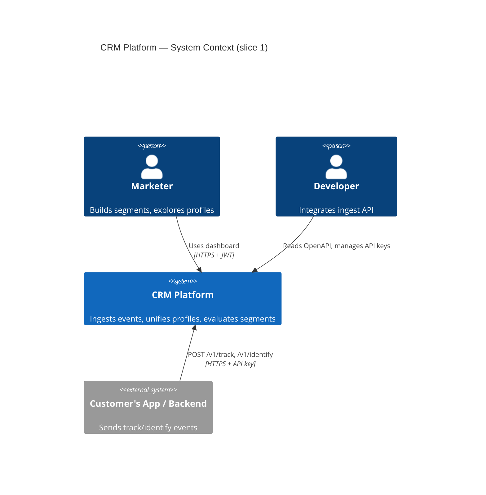
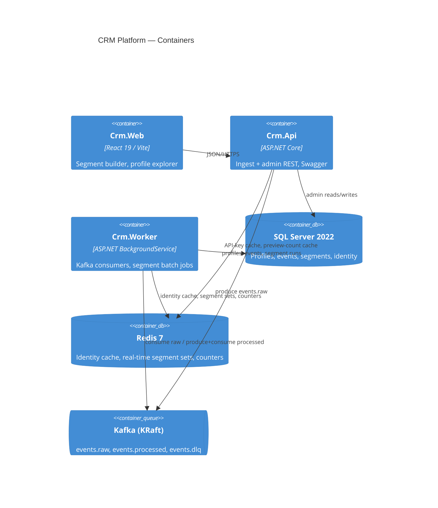

# CRM Platform — Slice 1 Design: Events → Profiles → Segments

- **Date:** 2026-09-15
- **Status:** Approved for planning
- **Scope:** Sub-project 1 of a MoEngage-style customer engagement platform
- **Purpose of project:** Portfolio / learning. Architecture quality and documentation weigh as much as feature count.

---

## 1. Context and goals

MoEngage is a multi-tenant customer engagement platform: ingest user events, build unified profiles, segment users, and orchestrate campaigns across channels. This project rebuilds that platform as a set of sub-projects. Slice 1 is the foundation every later slice depends on:

1. **Ingest** events and identity calls at high throughput.
2. **Resolve** identities into unified **profiles** with attributes and an event timeline.
3. **Segment** profiles with a rule builder, evaluated both in batch (SQL) and in real time (stream).

### 1.1 Decisions locked during brainstorming

| Axis | Decision |
|---|---|
| Stack | .NET 10 (C#), React 19 + TypeScript, SQL Server 2022, Redis 7, Kafka (KRaft) |
| Architecture | Modular monolith, one solution, schema-per-module |
| Tenancy | Multi-tenant, shared DB, `TenantId` column + EF Core global query filters |
| Ingestion path | API → Kafka → Worker |
| Profile storage | Core columns + JSON `Attributes`; promoted computed columns for hot keys |
| Segmentation | Hybrid: batch SQL materialization + real-time Redis sets for eligible rules |
| Auth | ASP.NET Identity + JWT for dashboard; per-tenant API keys for ingest |
| UI slice 1 | Segment builder + profile explorer |
| Runtime | docker-compose, local only |
| Docs | BRD, ADRs (MADR), design spec + C4 diagrams, OpenAPI, data dictionary |

### 1.2 Success criteria for slice 1

- `docker compose up` brings up the whole system; README shows it in 3 commands.
- An event posted to `/v1/track` appears in the profile timeline within 2 s (p95, local).
- A segment with mixed attribute + event rules returns correct members in batch; a real-time-eligible segment updates its Redis set within 2 s of the triggering event.
- Tenant A can never read tenant B data (integration test proves it).
- Load test: 1,000 events/s sustained for 60 s locally with consumer lag returning to zero within 30 s.
- All doc deliverables in §9 exist and are linked from README.

### 1.3 Out of scope for slice 1

Campaign sending, journeys/flows, analytics dashboards, channel adapters, mobile/web SDKs, AI features, behavioral sequence rules ("did A then B"), cross-tenant users, Azure deployment.

---

## 2. Architecture

### 2.1 System context (C4 L1)



### 2.2 Containers (C4 L2)



### 2.3 Modular monolith layout

```
Crm.sln
src/
  Hosts/
    Crm.Api/                 ASP.NET Core host: ingest + admin REST, Swagger, rate limiting
    Crm.Worker/              BackgroundService host: Kafka consumers, batch jobs
    Crm.Web/                 React (Vite + TS); separate dev server, static in compose
  Modules/
    Ingestion/
      Ingestion.Application  validation, event envelope, Kafka producer port
      Ingestion.Infrastructure Confluent.Kafka producer adapter
    Profiles/
      Profiles.Domain        Profile, UserIdentity, Event, merge rules
      Profiles.Application   commands (ResolveIdentity, ApplyEvent), queries (search, timeline)
      Profiles.Infrastructure EF DbContext (schema profiles), repositories, Redis identity cache
    Segmentation/
      Segmentation.Domain    RuleTree, RuleNode types, RealtimeEligibility
      Segmentation.Application RuleCompiler, SegmentRunner, RealtimeEvaluator, preview
      Segmentation.Infrastructure EF DbContext (schema segments), Redis sets, Kafka consumer
    Tenancy/
      Tenancy.Domain         Tenant, ApiKey
      Tenancy.Application    auth, key issuance
      Tenancy.Infrastructure ASP.NET Identity (schema identity), JWT, API key hashing
  Shared/
    Crm.Contracts/           integration events: TrackEventRaw, EventTracked, ProfileUpdated; shared DTOs
    Crm.Kernel/              Entity base, Result<T>, ITenantContext, IClock, error types
tests/
  Ingestion.UnitTests/  Profiles.UnitTests/  Segmentation.UnitTests/  Tenancy.UnitTests/
  Crm.IntegrationTests/    Testcontainers: SQL Server + Kafka + Redis
  Crm.ArchTests/           NetArchTest module boundary rules
  Crm.LoadTests/           k6 scripts
  Crm.Web/ (Vitest + Playwright inside web project)
docs/
  brd/  adr/  design/  api/  data-dictionary/  superpowers/specs/
deploy/
  docker-compose.yml  docker-compose.observability.yml  sql/init.sql
```

### 2.4 Module dependency rules (enforced by `Crm.ArchTests`)

- Every module may depend on `Crm.Kernel` and `Crm.Contracts` only.
- `Ingestion` has no database and no dependency on other modules.
- `Segmentation` does **not** reference `Profiles` assemblies. It reads `profiles.Profiles` and `profiles.Events` tables via raw SQL in its own infrastructure project. This is a documented exception (ADR-0009) chosen over replicating profile data.
- Hosts reference module Infrastructure projects for DI registration only; no host code calls module internals.
- No module references a Host.

### 2.5 Tenant isolation

- Middleware resolves the tenant from either a JWT `tenant_id` claim or an `X-Api-Key` header and populates a scoped `ITenantContext`.
- Every module entity carries `TenantId`. Each DbContext applies a global query filter `e.TenantId == tenant.Id`. `SaveChanges` interceptor stamps `TenantId` on inserts and throws if it differs.
- Resolving a request without a tenant throws `TenantContextMissingException` (500, logged as a bug) rather than returning unfiltered data.
- Kafka messages carry `TenantId` in both a header and the payload. Consumers create a tenant scope per message.
- Every key is prefixed `t:{tenantId}:` except keys resolved before a tenant is known (`apikey:{prefix}`) and the global control channel `segments:changed`, whose payload carries the tenant id.

---

## 3. Data model

All tables have `TenantId UNIQUEIDENTIFIER NOT NULL`, `CreatedAt`, `UpdatedAt`. IDs are UUIDv7 (`Guid.CreateVersion7()`).

### 3.1 Schema `profiles`

**Profiles**

| Column | Type | Notes |
|---|---|---|
| Id | uniqueidentifier PK | |
| TenantId | uniqueidentifier | clustered index (TenantId, Id) |
| ExternalId | nvarchar(128) null | customer's user id |
| Email | nvarchar(256) null | normalized lower-case |
| Phone | nvarchar(32) null | E.164 |
| Attributes | nvarchar(max) | JSON object, validated `ISJSON` |
| FirstSeenAt / LastSeenAt | datetime2 | |
| EventCount | bigint | maintained by worker |
| MergedIntoId | uniqueidentifier null | non-null means this profile is a merge loser; excluded from all reads |
| Promoted computed columns | e.g. `Attr_plan AS JSON_VALUE(Attributes,'$.plan') PERSISTED` | created per tenant hot-key list via migration helper; slice 1 ships a fixed list: `plan`, `country`, `city` |

Indexes: unique filtered `(TenantId, ExternalId)`, `(TenantId, Email)`, `(TenantId, Phone)` where not null; `(TenantId, LastSeenAt DESC)`; one index per promoted column.

**UserIdentities**

| Column | Type | Notes |
|---|---|---|
| TenantId, Kind, Value | PK | Kind ∈ `external_id`, `anonymous_id`, `email`, `phone` |
| ProfileId | FK → Profiles | |

**Events** (partitioned by month on `OccurredAt`)

| Column | Type | Notes |
|---|---|---|
| Id | uniqueidentifier | UUIDv7, unique nonclustered (idempotency) |
| TenantId | uniqueidentifier | |
| ProfileId | uniqueidentifier | |
| Name | nvarchar(64) | |
| Properties | nvarchar(max) | JSON |
| OccurredAt | datetime2 | client timestamp, clamped to ±7 d of `ReceivedAt` |
| ReceivedAt | datetime2 | |

Clustered index `(TenantId, ProfileId, OccurredAt)`; nonclustered `(TenantId, Name, OccurredAt)` for segment event predicates.

### 3.2 Schema `segments`

**Segments**: Id, TenantId, Name, Description, `Definition` (JSON rule tree), `DefinitionVersion` int, `IsRealtimeEligible` bit, `CurrentRunId` null, `MemberCount` int, `LastRunAt`, `Status` (Draft/Active/Archived).

**SegmentRuns**: RunId, SegmentId, TenantId, StartedAt, FinishedAt, Status, MemberCount, CompiledSql (for audit/debug).

**SegmentRunMembers**: RunId, ProfileId (PK), TenantId.

**MembershipChanges**: Id, TenantId, SegmentId, ProfileId, Change (`Entered`/`Exited`), Source (`Batch`/`Realtime`), OccurredAt. Consumed by future campaign triggers.

### 3.3 Schema `identity`

ASP.NET Identity default tables plus `Tenants` (Id, Name, Slug, Status) and `ApiKeys` (Id, TenantId, Prefix, KeyHash sha256, Name, CreatedAt, RevokedAt, LastUsedAt). Users belong to exactly one tenant (`Users.TenantId`). Roles: `Admin`, `Viewer`.

### 3.4 Redis keys (complete list for slice 1)

| Key | Type | TTL | Purpose |
|---|---|---|---|
| `t:{tenant}:id:{kind}:{value}` | string → ProfileId | 1 h | identity lookup cache |
| `t:{tenant}:seg:{segId}:members` | SET of ProfileId | none | real-time membership |
| `t:{tenant}:seg:{segId}:ev:{eventName}:{window}:{profileId}` | string counter | = that leaf's window | real-time event count in window; one key per (segment, event leaf) so two leaves on the same event with different windows stay separate |
| `t:{tenant}:preview:{defHash}` | string count | 60 s | live count cache |
| `apikey:{prefix}` | string → TenantId | 10 min | API key resolution cache |

SQL Server is the single source of truth. Every Redis key can be rebuilt (identity cache from `UserIdentities`, segment sets by replaying `events.processed` or a batch run).

### 3.5 Kafka topics

| Topic | Key | Producer | Consumers | Payload |
|---|---|---|---|---|
| `events.raw` | `{tenantId}:{userKey}` | Api | Worker (group `profiles`) | `TrackEventRaw` / `IdentifyRaw` |
| `events.processed` | `{tenantId}:{profileId}` | Worker | Worker (group `segmentation`) | `EventTracked`, `ProfileUpdated` |
| `events.dlq` | same as source | Worker | none (manual) | original bytes + `error` header |

Partitions: 12 each locally. Retention: raw 7 d, processed 7 d, dlq 30 d.

---

## 4. Ingestion and profile pipeline

### 4.1 Ingest API

Endpoints (auth `X-Api-Key`, rate limit per key: token bucket 2,000 req/min, 429 on exceed):

- `POST /v1/track` — `{ userId? , anonymousId?, event, properties?, timestamp? }`; at least one of `userId`/`anonymousId` required.
- `POST /v1/identify` — `{ userId, anonymousId?, traits? }`; links anonymous → known and merges traits into `Attributes`.
- `POST /v1/batch` — `{ events: [...] }`, max 500 items, each validated independently; response lists per-item accepted/rejected. Each item carries a `type` discriminator (`track` or `identify`) selecting which shape and validation rules apply.

Per request: FluentValidation (event name ≤ 64 chars, alnum + `_`; properties ≤ 32 KB; timestamp within ±7 d), assign `EventId` (UUIDv7), stamp `TenantId` and `ReceivedAt`, produce to `events.raw` with `acks=all`, return `202 { eventId }`. No database access on this path.

**Rulings (plan D).** The Kafka key is `{tenantId:N}:{userKey}` — `userKey` is `userId` when present, else `anonymousId` — with headers `tenant-id` (`N`), `message-type` (`TrackEventRaw` / `IdentifyRaw`), `content-type`, and `traceparent` when an activity exists (D5). Limits beyond the ones above, chosen so nothing the API accepts is unstorable later: `userId` ≤ 128 chars, `anonymousId` ≤ 256 chars, `traits` ≤ 32 KB like `properties`; `properties`/`traits` must be JSON objects when present; blank strings count as absent (D6). The event-name pattern is anchored with `\z`, not `$`, so a trailing newline is rejected rather than accepted (D7). The producer is configured `acks=all`, `enable.idempotence=true`, `linger.ms=5`, `message.timeout.ms=3000`; the handler awaits the delivery report before answering `202`, and a failed or timed-out delivery answers `503` — *unconfirmed*, not *absent*: a request the broker received just before it stalled may still be appended, so clients retry and the pipeline tolerates the retry as a separate event rather than deduplicating client retries (redelivery of the same message is still deduplicated downstream) (D8). `/batch` treats envelope errors (`events` missing, empty, or more than 500 items) as `400`; item errors never fail the request — `202 { accepted, rejected, results }` even when every item is rejected — and a Kafka failure on any accepted item makes the whole request `503`; `BatchItem` is one flat DTO with a `type` discriminator rather than polymorphic deserialization (D9). Metrics: counters `crm_ingest_events_total{type}` (`track`/`identify`, counted after the broker acknowledges) and `crm_ingest_rejected_total{reason}` (`validation`/`unavailable`); rate-limited requests are not counted here, since the limiter lives in Tenancy (D10). The `ingest` rate-limit policy charges one token per request, by design (spec: "rate limit per key: token bucket 2,000 req/min"); a `/batch` call is one request regardless of item count, so a key's effective ceiling is 1,000,000 events per minute rather than 2,000 — a known limitation, with per-event quotas left as future work (D14).

### 4.2 Worker — `events.raw` consumer

Per message, inside one tenant scope and one SQL transaction:

1. **Identity resolve.** Look up `(Kind, Value)` in Redis, then `UserIdentities`. On miss, create Profile + identity row.
2. **Merge** (identify only, when `anonymousId` maps to profile A and `userId` maps to profile B, A ≠ B): winner = profile with earlier `FirstSeenAt`; loser's `Events.ProfileId` re-pointed, loser's identities re-pointed, loser's `Attributes` merged into winner (winner's values win on conflict), loser marked `MergedIntoId = winner`. Publish `ProfileMerged`.
3. **Upsert profile.** For `track`, update `LastSeenAt` and `EventCount += 1`. For `identify`, update `LastSeenAt` and attributes only (apply traits with `JSON_MODIFY` per key, last write wins); `identify` never creates an Events row and never changes `EventCount`. After a merge, the winner's `EventCount` is recomputed as `COUNT(*)` of its Events inside the merge transaction.
4. **Append event.** For `track`, insert into `Events`. Duplicate `(Id, OccurredAt)` (unique index violation) → no SQL write; `EventTracked` is published again, so `events.processed` is at-least-once and consumers dedupe by `eventId`.
5. Commit, then produce `EventTracked` / `ProfileUpdated` to `events.processed`, then commit Kafka offset.

Semantics: at-least-once delivery + idempotent insert = effectively-once. Kafka ordering is guaranteed per identifier key, not per person. A merge and a concurrent event for the same person can land on different partitions; correctness comes from row locks on the two profile rows during the merge plus the applier following `MergedIntoId` to the winner:

1. Merge runs in one SQL transaction that first takes `UPDLOCK, HOLDLOCK` on both profile rows (`SELECT ... WITH (UPDLOCK, HOLDLOCK) WHERE Id IN (winner, loser)`).
2. The event applier, before inserting an event, locks its resolved profile row the same way and, if `MergedIntoId` is not null, follows it to the winner (loop until null) and applies there.
3. Identity-cache entries for the loser's identities are deleted inside the merge transaction, before commit.

**Rulings (plan E).** Traits are applied in the domain under the profile row lock (`UPDLOCK, HOLDLOCK`) and the whole `Attributes` document is written back, instead of one `JSON_MODIFY` per key as sketched above; a JSON `null` trait value removes the key, matching what `JSON_MODIFY` does in lax mode (E2). `FirstSeenAt` and `LastSeenAt` use the API's `ReceivedAt`, never the client's `OccurredAt`, and `LastSeenAt` never moves backwards (E3). `OccurredAt` is truncated to milliseconds and clamped to `ReceivedAt ± 7 d` before it is used, because the column is `datetime2(3)` and the idempotency key is `(Id, OccurredAt)`: an untruncated value would miss the duplicate check and then collide on the unique index (E4). `track` never merges: with both `userId` and `anonymousId`, the `userId` profile wins when it exists, an unmapped `anonymousId` is attached to it, and an anonymous-only profile that has no `ExternalId` yet is promoted to the known user; `identify` merges only when the anonymous profile has no `ExternalId` — if it already belongs to another known user (shared device) nothing is merged and the anonymous id stays where it is (E5). `identify` traits `email` and `phone` (strings) are additionally promoted, normalized into `Profiles.Email` / `Profiles.Phone` and an identity row of that kind, but only when the identity is unmapped or already this profile's; a value owned by another profile is left in `Attributes` only — no merge by e-mail or phone in slice 1 (E6). A duplicate event (`(Id, OccurredAt)` already exists) skips every SQL write but still publishes `EventTracked` — otherwise a crash between the SQL commit and the produce would lose the processed message for good, since the redelivery is a duplicate — so `events.processed` is at-least-once and a consumer that must count exactly once dedupes by `eventId` (a constraint the Segmentation plan inherits); `ProfileUpdated` and `ProfileMerged` carry no idempotency key, so the same crash window can still lose one of those, but every later `EventTracked` carries the full profile snapshot and the next batch run heals membership (ADR-0005) — a transactional outbox is the future fix (E7). The Worker runs `Profiles:Consumer:Instances` consumers (default 4) in group `profiles`; Kafka spreads the 12 partitions over them and each processes sequentially, so per-key order holds, and offsets are committed synchronously per message (E10). The consumer does not subscribe until schema `profiles` exists (`SchemaGate` polls every 2 s), because in compose the API applies migrations in Development and the Worker may start first; without the gate, valid messages would be dead-lettered for "Invalid object name" (E11). Redis is a cache: a Redis error is logged and treated as a miss and never fails a message; cache writes happen after the SQL commit, cache deletes (merge) happen before it, and a delete cancels a pending write for the same key (E12). While `ProcessedEventPublisher` retries a persistent `events.processed` produce failure, that consumer instance processes nothing and its `crm_consumer_lag` series is not refreshed — `crm_publish_retries_total{topic}` increasing is the signal for that state (final review I1). `Profile.Attributes` has no size or key-count cap: it accumulates without bound across `identify` calls, and every `identify` rewrites the whole document under the row lock; a cap with a defined rejection behaviour (reject, truncate, or dead-letter) is backlog before any public exposure (final review I3).

**Rulings (plan F).** The three read endpoints use a keyset cursor, Base64Url of `1|<scope>|<ticks>|<id>` with scope `profiles` or `events` (`KeysetCursor` in `Crm.Kernel.Paging`); it is not tenant-bound — it only positions a keyset inside a query the tenant filter already scopes — and is opaque, not a stable snapshot, so it can shift under concurrent writes (F2). `limit` defaults to 50 and accepts 1…200; anything else is `400 pagination.invalid_limit` — no silent clamp (F3). Search sorts `LastSeenAt DESC, Id DESC`; the timeline sorts `OccurredAt DESC, Id DESC`, with `Id` only breaking ties, so an event with an old client timestamp sorts where that timestamp puts it (F4). `q` is optional; when present it is trimmed, capped at 256 chars, and matched as a prefix against `ExternalId`, `Email`, and — when it looks like a phone number — `Phone`; LIKE metacharacters are escaped and case-insensitivity comes from the database's default collation (F6). Search rows are thin (`id, externalId, email, phone, lastSeenAt, eventCount`); only the detail endpoint returns `attributes` and `firstSeenAt`, since `Attributes` is uncapped (F7). A missing, foreign-tenant, or merged profile is indistinguishable: both `/{id}` and `/{id}/events` answer `404 profile.not_found` on all three, so a client cannot use the API to detect a merge (F8). Timeline filters: `name` must match `^[A-Za-z0-9_]{1,64}$`, `from` is inclusive and `to` exclusive, and `from >= to` is rejected, all as `400 profiles.invalid_filter` (F9). The read endpoints carry no rate limiter — they are JWT-only, so abuse needs a login (F10). Every timestamp in a read response is UTC with a `Z` suffix (`DateTime.SpecifyKind` before serialization), and `attributes`/`properties` are parsed JSON, not strings (F11). The demo dataset (5,000 profiles, 100,000 events, 50 merges) is loaded by `SqlBulkCopy`, not the ingest pipeline — one synchronous Kafka commit per event cannot fit the `make seed` budget at that volume — and a fixed quota table of plan × country × dormancy cells reproduces the six documented segment counts exactly, with a seeded PRNG only shuffling and filling (F12, F13). Profile `u-00001` is pinned as an active pro purchaser in `ID` with more than 120 events, for E2E-006 (F14). The loader verifies its six counts with SQL inside the same transaction and rolls back on a mismatch; the Development-only `POST /v1/dev/seed-dataset` (`AdminOnly`, excluded from OpenAPI) is idempotent — a tenant that already has the pinned profile reports `exists` (F15). Final review follow-ups: the read endpoints have no rate limiter (F10), so the Web client must debounce search (§7); `GET /v1/profiles/{id}` is the first endpoint that returns the uncapped `attributes` document (plan E final-review I3 is now also a response-size concern, not only an unbounded-write concern); and both keyset queries sorted per page rather than seeking it (data dictionary "Read paths") — resolved by plan G's covering indexes, measured on the cached execution plan. Live verification also found that on a fresh volume the Worker, which starts in parallel and only waits for the schema, could already hold a session in the brand-new Development database by the time EF Core's own database creator issued its unguarded `ALTER DATABASE … SET READ_COMMITTED_SNAPSHOT ON`, which then waited on that session until its 60 s command timeout and crashed the API; the API now creates the database itself before migrating and switches the option on `WITH ROLLBACK IMMEDIATE`, which disconnects whatever session slipped in (F18).

**Rulings (plan G).** Plans are asserted on what SQL Server actually compiled for the API's own statement: the list queries carry `TagWith("profiles-search")` / `TagWith("profiles-timeline")`, and tests call the HTTP endpoint then read the newest cached plan whose text contains the tag — no hand-written reconstruction of the SQL (G1). The profile browse/search index `IX_Profiles_TenantId_LastSeenAt_Id` on `(TenantId, LastSeenAt DESC, Id DESC) INCLUDE (ExternalId, Email, Phone, EventCount) WHERE MergedIntoId IS NULL` replaces `IX_Profiles_TenantId_LastSeenAt`, serving filter, order, tiebreak and projection in one ordered scan; the cost is wider index rows on `EventCount`, a column that changes on every event (G2). Cursor predicates for both paths are seekable — `sort <= @at AND (sort < @at OR Id < @id)` rather than the disjunctive `sort < @at OR (sort = @at AND Id < @id)` — so SQL Server seeks to the cursor position instead of scanning from the start of the index (G3). `q` stays a residual predicate on the ordered index scan; the three contact columns are INCLUDEd, so no lookup is needed, but a rare match on a very large tenant still scans until it fills a page — accepted for slice 1 (G4). The Events clustered index became unique on `(TenantId, ProfileId, OccurredAt, Id)`, renamed `CX_Events_TenantId_ProfileId_OccurredAt_Id`, as measured rather than assumed (G5/G6): a timeline restricted to one month (one partition) compiles with no Sort operator, so the change stands; the unrestricted timeline (paging across partitions) still shows a Sort over per-partition seeks (`Top > Sort > Clustered Index Seek`) because the optimizer does not treat partition order as `OccurredAt` order end to end — both behaviours are measured by `ReadPathPlanTests` and recorded in the data dictionary. `profiles.Events` also got `LOCK_ESCALATION = AUTO`, so escalation targets the month partition rather than the whole table (G7). The `name` filter on the timeline stays a residual predicate on the profile's range; the partition function, `UX_Events_Id`, `IX_Events_TenantId_Name_OccurredAt` and the Worker's raw statements are unchanged — that index is keyed for Segmentation's tenant-wide counts (G8). The pattern every later keyset list should copy, starting with Segmentation's members/changes/runs: a filtered or covering index keyed `(TenantId, <sort> DESC, Id DESC)`, the conjunctive cursor predicate, a `TagWith` tag, and a plan test that measures rather than assumes.

### 4.3 Failure handling

- Transient SQL/Redis errors: three attempts with waits of 200 ms and 2 s (configurable; a plain loop, no Polly), then treat as poison. Every exception from processing is retried, not a fixed list of transient types (E8).
- Poison message: produce to `events.dlq` with `error`, `stack`, `attempt` headers; commit offset; increment `crm_dlq_total{topic}`.
- Kafka unavailable at ingest: API returns 503 `problem+json` (`ingest.unavailable`, `Retry-After: 5`) per ruling D8; never buffers in memory.
- Worker never crash-loops on a single bad message.
- Failures after the SQL commit (hook, publish, DLQ produce, offset commit) never dead-letter: the consumer loop is rebuilt after a delay and Kafka redelivers from the last committed offset; idempotency makes that safe (E9).

---

## 5. Segmentation

### 5.1 Rule tree (stored JSON, `DefinitionVersion` = 1)

```json
{
  "op": "and",
  "children": [
    { "type": "attribute", "key": "plan", "cmp": "eq", "value": "pro" },
    { "type": "event", "name": "purchase", "cmp": "gte", "count": 3, "window": "30d" },
    { "op": "or", "children": [
      { "type": "attribute", "key": "country", "cmp": "in", "value": ["ID", "SG"] },
      { "type": "event", "name": "app_open", "cmp": "eq", "count": 0, "window": "7d" }
    ]}
  ]
}
```

Node types:

- `group`: `op ∈ and | or | not` (`not` has exactly one child), `children[]`.
- `attribute`: `key`, `cmp ∈ eq | neq | in | nin | gt | gte | lt | lte | contains | exists | not_exists`, `value` (string | number | bool | array). Type inferred from JSON value; numeric compares cast with `TRY_CONVERT(float, ...)`.
- `event`: `name`, `cmp ∈ eq | gte | lte`, `count` ≥ 0, `window` in `Nd` / `Nh` (max 365 d).

Limits: depth ≤ 5, leaves ≤ 20. Validated by a shared Zod schema (frontend) and a C# validator (backend) generated from the same fixture set.

### 5.2 Compiler

`RuleCompiler.Compile(RuleTree, TenantId) → CompiledQuery { Sql, Parameters }`. Pure, deterministic, no I/O.

- Root always: `SELECT p.Id FROM profiles.Profiles p WHERE p.TenantId = @tenant AND p.MergedIntoId IS NULL AND (<tree>)`.
- `attribute` on a promoted key → `p.Attr_plan = @p0`; otherwise `JSON_VALUE(p.Attributes, '$.plan') = @p0`. `exists` → `IS NOT NULL`. `in` → table-valued parameter or `IN (@p0, @p1, ...)`.
- `event` → `EXISTS (SELECT 1 FROM profiles.Events e WHERE e.TenantId = @tenant AND e.ProfileId = p.Id AND e.Name = @p1 AND e.OccurredAt >= @p2 HAVING COUNT(*) >= @p3)`; `count = 0` → `NOT EXISTS (...)`.
- Every value is a parameter. JSON path is built from the validated key (`^[A-Za-z0-9_]{1,64}$`), never from raw input.

Full comparator mapping: architecture doc §6.

Tests: one unit test per node/comparator, plus golden-file tests (`rules/*.json` → `expected/*.sql`).

### 5.3 Batch materialization

`POST /segments/{id}/run` inserts a `SegmentRuns` row (Status = Queued) and returns immediately; a Quartz.NET job in the Worker polls `SELECT ... WHERE Status = 'Queued'` every 5 s and executes runs one per segment at a time, alongside its own 6-hour schedule for Active segments. No new Redis or Kafka artifact is needed to deliver the run.

1. Create `SegmentRuns` row (Status = Queued); the Worker sets Running when it picks the run up.
2. `INSERT INTO SegmentRunMembers (RunId, ProfileId, TenantId) <compiled SQL>`.
3. Diff against `CurrentRunId`: `EXCEPT` both ways → insert `MembershipChanges` (Entered / Exited, Source = Batch).
4. Update `Segments.CurrentRunId`, `MemberCount`, `LastRunAt`; mark run Finished.
5. If the segment is real-time eligible, rebuild the Redis set from the run (`DEL` + `SADD` in a pipeline) so batch corrects drift.
6. Prune runs older than the last 3.

Command timeout 5 min; failure marks run Failed with error text; segment keeps previous run.

### 5.4 Real-time evaluation

`RealtimeEligibility.Classify(tree)` returns eligible iff: no `not` group, every `attribute` leaf uses any comparator (attributes are fully known from the profile snapshot), every `event` leaf has `cmp ∈ gte` and `count ≥ 1`. Zero-count and negation need knowledge of absence and stay batch-only. Result stored in `Segments.IsRealtimeEligible` and shown as a badge in the UI.

Worker consumer (group `segmentation`) on `EventTracked` / `ProfileUpdated`:

1. Load the tenant's eligible Active segments from an in-memory cache (invalidated by a `segments:changed` Redis pub/sub message on save).
2. For `EventTracked`, `INCR t:{tenant}:seg:{seg}:ev:{eventName}:{window}:{profile}` then `EXPIRE key window NX` (set TTL only when absent) for each (segment, event leaf) referencing that event name.
3. Evaluate the tree in C# (`RealtimeEvaluator`) against the profile snapshot in the message plus counters.
4. `SADD` / `SREM` the membership set; on transition write `MembershipChanges` (Source = Realtime).

Approximation accepted and documented: the counter TTL is a sliding-ish window (reset on expiry, not per-event decay). Batch runs correct any drift.

### 5.5 Preview count

`POST /v1/segments/preview { definition }` → validate → compile → `SELECT COUNT(*)` with a 5 s command timeout → cache in Redis by SHA-256 of the canonical definition for 60 s. Timeout returns `{ count: null, timedOut: true }` and the UI shows "too slow to preview; save and run".

---

## 6. API surface

Base path `/v1`. Errors are RFC 9457 `application/problem+json` with `traceId`. Pagination is cursor-based (`?cursor=&limit=` ≤ 200). OpenAPI generated from code at build, committed to `docs/api/openapi.json`; CI fails if the generated file differs.

| Group | Auth | Endpoints |
|---|---|---|
| Ingest | API key | `POST /track`, `POST /identify`, `POST /batch` |
| Profiles | JWT | `GET /profiles?q=` (email / externalId / phone prefix), `GET /profiles/{id}`, `GET /profiles/{id}/events?from&to&name&limit&cursor` |
| Segments | JWT | `GET /segments`, `POST /segments`, `GET/PUT/DELETE /segments/{id}` (`GET /segments/{id}` includes `realtimeMemberCount`, the live `SCARD` of the members set, `null` when not real-time eligible), `POST /segments/preview`, `POST /segments/{id}/run`, `GET /segments/{id}/runs`, `GET /segments/{id}/members?cursor`, `GET /segments/{id}/changes?since&cursor` |
| Tenancy | JWT (Admin) | `POST /auth/login`, `POST /auth/refresh`, `POST /tenants` (bootstrap, dev only), `GET/POST /api-keys`, `DELETE /api-keys/{id}` |
| Ops | none | `GET /health/live`, `GET /health/ready`, `GET /metrics` (served at the host root, not under `/v1`) |

Auth details:

- JWT: HS256 dev / RS256 configurable, 15 min access, claims `sub`, `tenant_id`, `role`. The refresh token is an httpOnly, Secure, `SameSite=Strict` cookie named `crm_refresh`, path `/v1/auth`, valid 7 d. `POST /auth/login` returns `{ accessToken, expiresIn }` in the body; `POST /auth/refresh` takes no body, reads the cookie, and rotates it.
- API key format `crm_live_<32 base62>`; stored as SHA-256 hash + 8-char prefix; shown once on creation. Resolution: Redis `apikey:{prefix}` → SQL fallback, compare hash in constant time. `LastUsedAt` updated at most once per minute.
- Roles: `Admin` full; `Viewer` read-only on profiles/segments.

---

## 7. Web UI

React 19, Vite, TypeScript, TanStack Router + Query, shadcn/ui + Tailwind, Zod, typed client via `openapi-typescript` from the committed spec.

Routes:

1. `/login` — email/password → JWT in memory + refresh cookie.
2. `/profiles` — search input (debounced), results table (external id, email, last seen, event count), detail drawer: core fields, attributes JSON viewer, event timeline with infinite scroll and name filter.
3. `/segments` — list with member count, last run, real-time/batch badge, status.
4. `/segments/new`, `/segments/:id` — rule builder:
   - Nested AND/OR/NOT groups, add/remove/move rows, typed inputs per comparator.
   - Live count (debounced 500 ms, calls preview; shows spinner, cached result, or "too slow").
   - Save (validates with Zod, shows server problem+json field errors), Run now, Members tab (paged), Runs tab.

Builder state is a pure reducer over the same JSON tree shape the backend stores; the Zod schema is the frontend's contract and mirrors the C# validator via a shared fixture directory (`tests/fixtures/rules/valid/*.json`, `invalid/*.json`) run by both test suites.

Testing: Vitest + Testing Library for the reducer and builder components; Playwright smoke: login → create segment → see count → run → see members.

---

## 8. Cross-cutting

### 8.1 Error handling

- Application layer returns `Result<T>` with typed errors (`Validation`, `NotFound`, `Conflict`, `Forbidden`). Exceptions only for programmer errors and infrastructure faults.
- API maps `Result` errors to 400/404/409/403 problem+json; unhandled → 500 with `traceId`, details logged not returned.
- Worker retries, then DLQ (see §4.3). Batch job failures are recorded on the run and surfaced in the UI.

### 8.2 Observability

- OpenTelemetry: ASP.NET Core, HttpClient, EF Core, Confluent.Kafka instrumentation; trace context propagated in Kafka headers; exporter OTLP → Jaeger.
- Serilog structured logs with `TenantId`, `TraceId`, `ProfileId` enrichers; JSON console sink.
- Prometheus metrics: `crm_ingest_events_total`, `crm_ingest_rejected_total`, `crm_consumer_lag`, `crm_dlq_total`, `crm_publish_retries_total`, `crm_segment_run_seconds`, `crm_realtime_eval_seconds`.
- `docker-compose.observability.yml` adds Prometheus, Grafana (one provisioned dashboard), Jaeger.

### 8.3 Testing strategy

| Level | Tool | Covers |
|---|---|---|
| Unit | xUnit + FluentAssertions | identity merge rules, rule compiler (golden files), eligibility classifier, real-time evaluator, validators, API key hashing |
| Integration | xUnit + Testcontainers (SQL Server, Kafka, Redis) | ingest → worker → profile round-trip; identify merge; batch run on seeded data; real-time set update; tenant isolation (A cannot read B via API or query); DLQ on poison message |
| Architecture | NetArchTest | dependency rules in §2.4 |
| Contract | build step | OpenAPI drift check; rule fixture parity (C# and Zod agree on valid/invalid) |
| E2E | Playwright | login, build segment, preview, run, members |
| Load | k6 | 1,000 events/s for 60 s; report lag recovery and p95 ingest latency in README |

TDD applies to every unit in the plan: tests first, then implementation.

### 8.4 Local runtime

`deploy/docker-compose.yml`: `sqlserver` (2022, healthcheck), `kafka` (KRaft single node, topics created by init container), `redis`, `api`, `worker`, `web` (nginx serving Vite build, proxying `/v1` to api). Web published on port 3000, api on 8080. `make up`, `make seed` (creates tenant, admin user, API key, 5k demo profiles with 100k events), `make test`.

---

## 9. Documentation deliverables

All Markdown with Mermaid diagrams, under `docs/`:

| Path | Content |
|---|---|
| `docs/brd/BRD.md` | Vision, personas (marketer, developer, tenant admin), slice 1 scope, roadmap, numbered FRs (FR-01…), NFRs (throughput, latency, isolation, availability targets for local), out-of-scope, glossary |
| `docs/adr/0001-modular-monolith.md` | Modular monolith over microservices |
| `docs/adr/0002-kafka-ingestion.md` | Kafka over Redis Streams / RabbitMQ / sync writes |
| `docs/adr/0003-sql-server-json-profiles.md` | Core columns + JSON over EAV / Redis-primary |
| `docs/adr/0004-shared-db-tenancy.md` | Shared DB + TenantId over DB-per-tenant |
| `docs/adr/0005-hybrid-segmentation.md` | Batch + real-time with eligibility classifier |
| `docs/adr/0006-redis-roles.md` | Redis as rebuildable cache only |
| `docs/adr/0007-auth-model.md` | ASP.NET Identity JWT + hashed API keys |
| `docs/adr/0008-run-and-swap-membership.md` | Immutable runs + diff table |
| `docs/adr/0009-segmentation-reads-profiles-tables.md` | Cross-module raw SQL read exception |
| `docs/design/architecture.md` | C4 L1–L3 diagrams, module map, sequence diagrams (ingest, identify-merge, batch run, real-time eval) |
| `docs/design/2026-09-15-crm-slice1-design.md` | Copy/link of this spec |
| `docs/api/openapi.json`, `docs/api/README.md` | Generated contract + usage guide with curl examples |
| `docs/data-dictionary/*.md` | Per schema: tables, columns, types, indexes, partitioning, retention; generated from EF model + hand notes |
| `README.md` | 3-command quickstart, architecture summary, links to all of the above, load-test results |
| `docs/test/*.md` | Test specification written before implementation: strategy, 125 cases (unit, integration, architecture, contract, end-to-end, load) in Given/When/Then, traceability matrix to every FR/NFR, seed dataset and rule/golden fixtures |

ADRs use MADR format: Context, Decision Drivers, Considered Options, Decision Outcome, Consequences.

---

## 10. Roadmap (later sub-projects, each with its own brainstorm → spec → plan)

1. **Slice 1 — this spec.**
2. **Campaigns:** email channel (MailHog locally), templates, send-to-segment, delivery/open events fed back through `events.raw`.
3. **Journeys / Flows:** DAG builder, triggers on `MembershipChanges`, waits, branches.
4. **Analytics:** funnels and retention over `Events` (columnstore index), campaign reports.
5. **Channels + SDKs:** push, SMS, WhatsApp adapters; JavaScript web SDK.
6. **AI:** send-time optimization, churn scoring.

---

## 11. Risks and mitigations

| Risk | Mitigation |
|---|---|
| `JSON_VALUE` predicates scan on large tenants | Promoted computed columns for hot keys; document limit; later slice adds per-tenant promotion UI |
| Identity merge edge cases (three-way, re-merge) | Explicit rules in §4.2; unit tests per scenario; merge loser kept, never deleted |
| Real-time counters drift from truth | Batch run rebuilds sets; UI badge sets expectation |
| SQL Server + Kafka containers heavy locally | Compose healthchecks + documented minimum resources (8 GB RAM); observability stack optional |
| Scope creep toward campaigns | §1.3 out-of-scope list; roadmap items require their own spec |
| A request with a missing or bogus API key bypasses the `ingest` rate limiter (no key prefix → no partition) while still costing a Redis GET and a SQL SELECT per request | Mitigated today only by the API-key cache; a per-client-address limiter is planned for the Tenancy hardening backlog before any public exposure (D15) |
